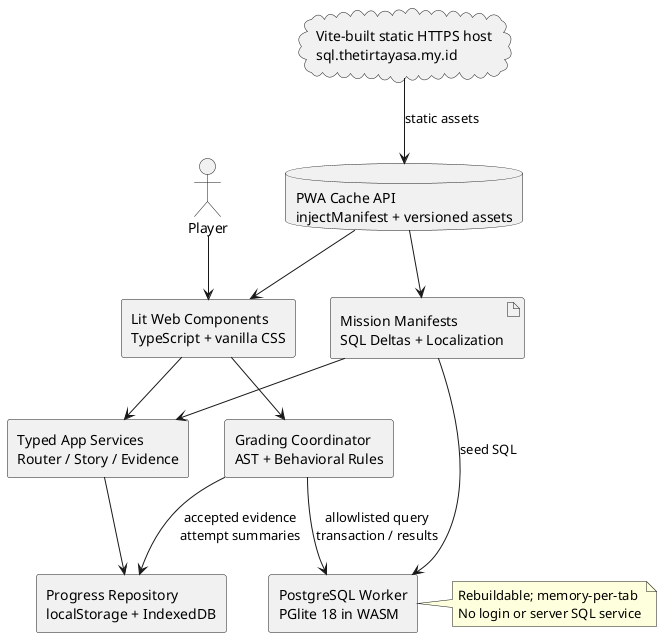
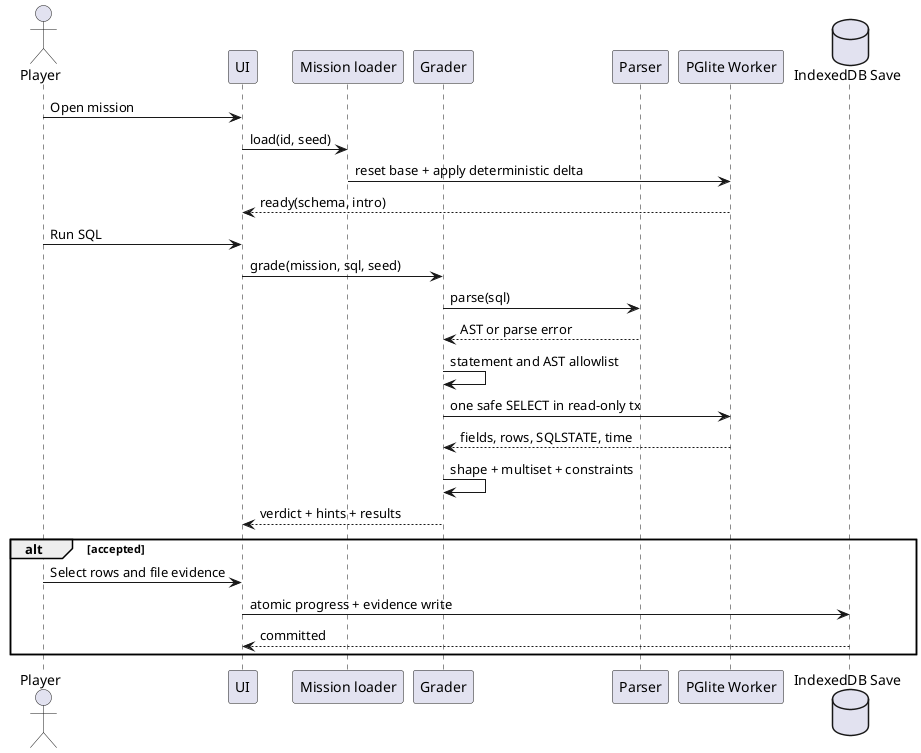
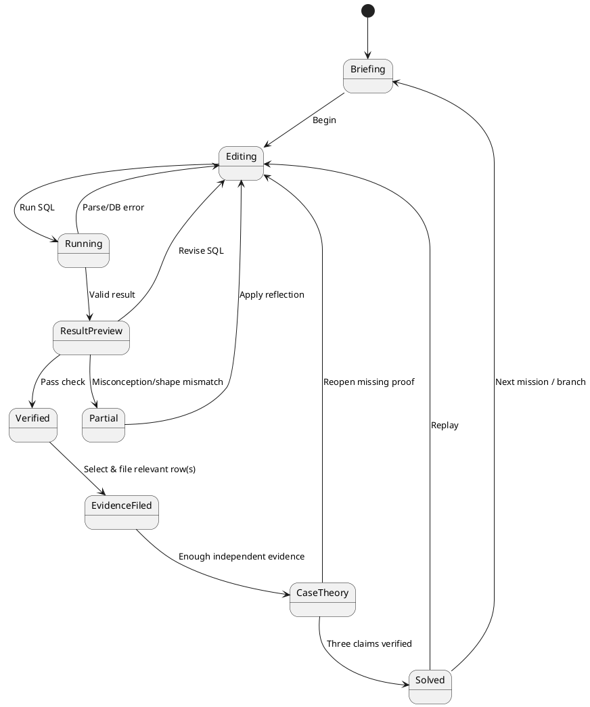

# SPEC-001-The Quiet Index: A PostgreSQL Detective Game

**Status:** Revised implementation specification v1.1 — selected technology architecture (implementation pending)  
**Date:** 2026-10-31  
**Target:** https://sql.thetirtayasa.my.id  
**Primary users:** Complete beginners through advanced SQL learners; independent learners, classrooms, and experienced analysts seeking practice  
**Delivery:** Free, account-free, static-first progressive web application (PWA)  
**Client:** Lit Web Components + strict TypeScript + Vite; semantic HTML5 and vanilla CSS design system; CodeMirror 6 SQL editor  
**SQL dialect:** PostgreSQL 18 only, via PGlite running locally in a dedicated Web Worker  
**Source of truth:** `SQL-Game-Research-Reports.md` (October 2026), supplemented by current primary technical documentation.  
**Decision labels:** `[R]` reported research evidence; `[D]` product/engineering decision; `[T]` assumption requiring real-device or playtest verification.
**Revision note:** v1.1 changes the delivery toolchain and UI implementation, **not** the gameplay scope or learning contract: 24 MVP missions / 80 full-release missions, seeded PostgreSQL behavior grading, local-first saves, and no mandatory backend remain unchanged. Lit is the only approved component library; Vite and TypeScript are build-time tools, not runtime services. [D]

> **Agent instruction:** This document is normative. Build the MVP specified in §Implementation/Phase 0–4 before expanding to all 80 missions. **Use Lit + TypeScript + Vite + vanilla CSS + CodeMirror 6 for the application UI**, with PGlite and the PostgreSQL AST parser isolated behind typed engine boundaries. Do not substitute SQLite, DuckDB, React, Vue, Svelte, Angular, a backend SQL service, or an answer-string-only grader. Keep output static and dependency-minimal; use no unapproved global state or UI component framework. Where an implementation detail is not verified, perform the stated spike/acceptance test before choosing a substitute. Preserve save-file compatibility and stable mission IDs across updates.

## Background

**The opportunity.** SQL Murder Mystery gives players a compelling URL and a database but grades a submitted name and does not retain progress; SQL Noir adds episodes, XP, localization, an interactive schema and persistence but still grades an answer name rather than the SQL used to derive it. The supplied research characterizes query-level diagnosis as the largest gap in the market, not lack of cosmetic gamification. SQL Island's 91% completion in a **compulsory graded class after two SQL labs** must not be mistaken for unaided public completion. Database Detective's Steam reception shows an appetite for production-grade story presentation, while reported crashes and save-loss complaints make reliability central to the learning experience. [R]

**Learning evidence.** In the PostgreSQL student-query study cited by the report, 54% of executions had syntax errors, roughly 40% ran but were semantically incorrect, and about 6% were correct; 51% of unsuccessful learners abandoned after failing to repair a syntax error. Reported persistent errors concentrate on omissions, grouping, missing joins, and self-joins. The report identifies particularly high difficulty for grouping-column rules and conceptual self-joins. Those observations inform **what** this game teaches and **how** it responds to mistakes. They are not claims about this future game's outcomes. [R]

**North-star product promise.** *“Solve a connected, increasingly high-stakes detective saga by writing real PostgreSQL, and understand why your SQL succeeds or fails.”* A player must be able to arrive with no SQL experience, complete a meaningful investigation in the first session, eventually use recursive CTEs, window functions, JSONB, set operations and query plans, and return without creating an account. [D]

### Goals and measurable success criteria

| ID | Goal | Acceptance / target |
|---|---|---|
| G1 | Teach transferable PostgreSQL | 80 authored missions across 10 acts, from `SELECT` to `EXPLAIN`; 24 fully playable missions in MVP; 0 SQLite-specific syntax in lessons or expected answers |
| G2 | Improve feedback rather than simply identify names | ≥95% of authored misconception fixtures produce the intended actionable diagnostic; all missions grade query behavior and applicable structural requirements |
| G3 | Respect alternative correct SQL | ≥2 independently authored correct solutions on each concept-neutral challenge, validated against ≥5 deterministic seeds or explicit strong structural constraints |
| G4 | Keep player agency and coherent narrative | First 16 missions have a guided spine; later acts expose optional spokes; major conclusions have ≥3 independently accessible evidence paths |
| G5 | Never require registration | 100% of solo play, progress, hints, case notes, export/import and endings available without an account |
| G6 | Preserve progress | 0 progress loss in automated crash/reload/update tests; export/import round-trip preserves 100% of mastered concepts, filed evidence, choices and solved mission IDs |
| G7 | Work well on real devices | WCAG 2.2 AA target; 360px width and keyboard support; ≥95% successful game boot on the tested browser matrix; performance budgets in §Method |
| G8 | Prove learning, not just engagement | In consenting pilot, pre/post concept quiz and diagnostic accuracy measured; target +20 percentage points on a locally developed 20-item assessment, *not* a published effect-size prediction |
| G9 | Remain maintainable by agents and contributors | Every mission has validated manifests, seeds, reference/negative fixtures and acceptance criteria; strict TypeScript, component contracts, code-quality checks and UI regression tests pass in CI |

**Scope distinction:** The MVP delivers 24 complete missions spanning basic querying, aggregation, joins and NULL. The **full release** delivers all 80 missions through advanced PostgreSQL and the complete season resolution. Thus “basic to advanced” is a committed full-product requirement, not a misleading claim about the initial MVP.

## Requirements

MoSCoW denotes **M**ust (release blocker), **S**hould (planned, not foundational), **C**ould (optional), **W**on't (explicitly excluded from v1). Traceability IDs must be referenced by mission fixtures, tests and milestones.

| ID | Priority | Requirement |
|---|---|---|
| R-001 | M | Only PostgreSQL syntax and behavior; no SQLite fallback or dialect switch. |
| R-002 | M | Implement UI with **Lit Web Components and strict TypeScript**; Vite compiles and bundles production HTML/CSS/JS. Keep styling in vanilla CSS with design tokens; no React/Vue/Svelte/Angular, CSS utility framework or required runtime Node server. |
| R-003 | M | Static HTTPS deployment to `sql.thetirtayasa.my.id`, functioning without app-server execution or login. |
| R-004 | M | Real local PostgreSQL engine running off the main UI thread and executable SQL result grid. |
| R-005 | M | Query-level grading: syntax, result shape, row multiplicity, content, order when specified, and concept-specific AST rules. Never validate only a suspect string. |
| R-006 | M | Explain SQLSTATE 42601, 42703, 42803, 42P01, 42702 with accessible actionable feedback; include grouping and Cartesian-product warnings. |
| R-007 | M | 24-mission initial playable release with authored plot, tutorial, alternative-valid-query tests, clues, notes, hints and resolution of act 3. |
| R-008 | M | Roadmap and content specification for all 80 missions / 10 acts, with a final multi-case mystery. |
| R-009 | M | Store small settings in `localStorage`, durable play records in IndexedDB, and offline artifacts in Cache API; never store progress solely in the SQL database. |
| R-010 | M | Versioned export/import JSON; ability to resume, replay, reset only a mission, and recover from missing/evicted browser storage where an export exists. |
| R-011 | M | Four-stage free hint ladder; no hint economy, lives, mandatory timer or penalty for seeking help. |
| R-012 | M | Deterministic seed-based datasets, build-time validation of solutions and wrong-answer fixtures, reproducible incident IDs. |
| R-013 | M | Responsive mobile/desktop UI with accessible navigation, result tables and no drag-only interaction; WCAG 2.2 AA. |
| R-014 | M | Gameplay permits multiple correct queries and does not enforce exact SQL text except where explicitly teaching a construct. |
| R-015 | M | Query safety and resource control: statement/type allowlisting, size ceilings, interrupt/reset path; no untrusted SQL sent to a privileged server. |
| R-016 | M | Native SQL learning embedded in the investigation: briefing, teaching, evidence retrieval, reasoning and explicit wrap-up. |
| R-017 | M | Anonymous, local-only by default; no analytics transmission, third-party trackers or user profile. |
| R-018 | S | Full 80-mission season, mastery challenges, spaced review and endgame branching. |
| R-019 | S | English and Bahasa Indonesia translation using stable string keys; SQL identifiers and keywords remain in English. |
| R-020 | S | Offline-first PWA install with complete current playable mission assets cached; clear offline/cache status. |
| R-021 | S | An interactive schema inspector, join-path diagram and bookmarkable query/result notebook. |
| R-022 | M | Provide a **CodeMirror 6 PostgreSQL editor in the MVP** with syntax highlighting, visible-schema-only autocomplete, indentation, query history, keyboard run (`Ctrl/Cmd+Enter`), accessible labeling, mobile keyboard support and a native-textarea fallback if an audited browser cannot mount the editor. |
| R-023 | S | Optional advanced practice mode for DML/DDL in disposable sandbox, safe to reset. |
| R-024 | S | Pre/post learning assessment and optional local-only opt-in diagnostic telemetry export for study. |
| R-025 | C | Achievement badges, visual detective rank, optional cosmetics and printable case report. |
| R-026 | C | Community-contributed cases via pull requests, classroom offline bundles and instructor answer guides. |
| R-027 | C | Optional server for authenticated shared progress, verified competitions or cloud sync **only if separately justified**. |
| R-028 | W | Login requirement, paywall, leaderboard requiring a backend, AI/LLM-generated live hints, multiplayer, real-money rewards and social tracking in v1. |
| R-029 | W | Advertising, account registration, third-party CDNs at runtime, client-to-public-Postgres connections or relying on an exposed secret. |
| R-030 | W | Hard time limits, punishment for syntax errors, or “game over” that erases learning progress. |
| R-031 | M | Use TypeScript `strict` and independent, typed domain/service/worker interfaces; prohibit SQL grading, progress migration, or evidence rules inside Lit UI components. |
| R-032 | M | Provide a versioned vanilla CSS design-token system, reusable accessible Lit components, reduced-motion handling and automated desktop/360px visual regression coverage. |
| R-033 | M | Use Vite static production build and `vite-plugin-pwa` with an authored `injectManifest` service worker, prompt-controlled activation and reproducible same-origin WASM/worker asset packaging. |
| R-034 | M | CI must pass `typecheck`, lint/format, Vitest unit tests, PostgreSQL fixture tests, Playwright E2E/visual checks and axe-core automated accessibility checks; manual assistive-tech and device verification remain mandatory. |

### Product principles and explicit trade-offs

1. **Correct SQL matters more than a guessed narrative answer.** The investigation's verdict is earned by query-backed evidence, not textual guessing. [D]
2. **Hints are educational material.** A bottom-out hint gives an annotated worked query, followed by a nearby variant; no XP/score loss. [R/D]
3. **A guided start, then meaningful freedom.** New players cannot get lost among 80 tasks; experienced players can replay and branch. [R/D]
4. **Narrative decisions are not always factual correctness.** A player may ethically choose to publish or protect sources after proving a case. Wrong accusations can be presented as reversible narrative branches, but may not falsely grant mastery. [D]
5. **Client-side cannot prevent cheating.** Static JS, test data and rubrics can be inspected. Seed variation discourages simply copying a suspect name; it is not DRM. Verified competitions would require a separate backend. [D]
6. **Preserve save data, rebuild SQL data.** PGlite catalogs are disposable; unique progress and the player's notes are not. [D]

## Method

### 1. Game identity and story architecture

**Working title:** *The Quiet Index*  
**Tagline:** *Every record is a witness. Every missing row is a lie.*  
**Setting:** Port Meridian, a rain-soaked coastal city preparing to replace its flood-defense network after the catastrophic North Quay storm. The player joins the Municipal Records Investigation Unit as a junior forensic analyst. Early cases seem small; their data expose a coordinated plan to falsify safety assessments, displace low-income neighborhoods and monetize redevelopment contracts.  
**Season motif:** `ECHO-17`, a recurring procurement/code token. Its appearances are cross-case clues, never required to solve any early case.  
**Principals:** Detective **Mara Voss** (mentor, insists on verifiable evidence), archivist **Niko Vale** (provides contextual records), engineer **Leila Arun** (credible whistleblower), contractor chief **Adrian Kestrel** (public suspect, imperfect alibi), deputy mayor **Celeste Rane** (political oversight), investigator **Jonas Iri** (source of a late betrayal), and **Tamsin Quill** (independent reporter who offers a morally complex finale). The actual organizer is revealed through advanced relational inference, not hardcoded text.

**Narrative data contract:** Each fictional person has a stable role and character ID, but **seeded, case-specific identities for suspects, couriers, shift officers, vehicle owners and document signatures may vary**. Clues are generated from relationships, not string matching to fixed names. Avoid depicting real-world persons or real events.

**The player's five repeatable actions:** (1) read a diegetic briefing; (2) inspect documented tables and learn a concept; (3) run PostgreSQL; (4) file selected rows as evidence with the producing query; (5) link evidence and submit a 3-part case theory. Each new mechanic is introduced by a quiet standalone “Records Office Bulletin,” never layered over dialogue.

**Investigation graph:** For each load-bearing conclusion, the content author declares three paths through distinct source relations or reasoning chains. E.g., for “warehouse van was present” use (a) vehicle gate logs, (b) shift badge records, (c) fuel invoices; none is a renamed duplicate of another. A player can follow any accessible path; a generic case resolution requires either three compatible proof slots or two independent high-confidence branches plus an explanatory reconciliation, as declared per case. Do not confirm isolated accusation guesses. The evidence board shows aggregate completeness, not which suspect answer is correct.

### 2. Ten-act season / learning syllabus

The following **80 missions are the authoritative full-release outline**. Mission sequence within each act is fixed for novice onboarding in acts 1–2; acts 3–9 may contain three interchangeable “spoke” missions while an act-level synthesis mission stays gated. SQL constructs listed are required *for the teaching role* only; for a free-practice role, alternatives remain valid.

| Act / missions | Main incident and narrative turn | Core PostgreSQL skills | End-of-act proof |
|---|---|---|---|
| **A1 — The Missing Receipt (001–008)** | A harbor clerk vanishes after a midnight delivery; security declares it a clerical mix-up. | `SELECT`, projection, aliases, `WHERE`, comparisons, `AND/OR`, `LIKE`, `ORDER BY`, `LIMIT` | Locate the suspicious shipment and produce its timeline |
| **A2 — Ghost Shift (009–016)** | The clerk's badge logs contradict payroll and overtime; first `ECHO-17` trace. | `COUNT`, `DISTINCT`, `SUM`, `MIN/MAX`, `GROUP BY`, `HAVING`, `CASE`, aggregation-column rules | Isolate an impossible overtime cluster and a planted time entry |
| **A3 — The False Alibi (017–024)** | The harbor guard is blamed; three independent systems disagree about who was at the quay. | Primary/foreign keys, `INNER JOIN`, 3-way joins, aliases, self-join introduction, `LEFT JOIN`, `IS NULL` | Exonerate or implicate with reproducible evidence, not a name |
| **A4 — The Missing Tide (025–032)** | Sensor readings disappear from the flood barrier system before a deadly storm drill. | NULL semantics, `COALESCE`, outer-join anti-match, `EXISTS`/`NOT EXISTS`, `FULL JOIN`, set-difference | Detect a missing measurement stream, not just suspicious measurements |
| **A5 — Glass Office (033–040)** | Procurement payments are distributed through front firms. | Joins + aggregation, grouped columns, conditional aggregation, `FILTER`, `HAVING`, anti-duplication | Reconstruct a hidden contract-beneficiary network |
| **A6 — Debt Map (041–048)** | Eviction orders align with flood-risk remapping; evidence is buried in layered views. | Subqueries, correlated queries, `WITH`, CTE scoping, `UNION`/`INTERSECT`/`EXCEPT`, `LATERAL` | Establish affected neighborhoods without double-counting residents |
| **A7 — The Broken Key (049–056)** | Maintenance timestamps and forged correspondence expose who moved the alert cutoff. | `DATE`, `TIMESTAMPTZ`, `AT TIME ZONE`, `DATE_TRUNC`, `EXTRACT`, interval arithmetic, regex/string functions, JSONB basics | Demonstrate the true action order across time zones |
| **A8 — The Echo Archive (057–064)** | Historical versions of records reveal recurring `ECHO-17` patterns across years. | `ROW_NUMBER`, `LAG/LEAD`, running totals, partitions, frames, `DISTINCT ON`, advanced JSONB, top-N per group | Recover the sequence of tampered records |
| **A9 — Flood Protocol (065–072)** | A command chain threatens to open the barrier during a storm; a director's chain of authority is obscured. | `WITH RECURSIVE`, cycle avoidance, hierarchical joins, `generate_series`, `ROLLUP`, `GROUPING SETS`, multi-source reconciliation | Trace authority to the controller and avert a false shutdown |
| **A10 — The Last Query (073–080)** | Mentor credibility is challenged, and the criminal network and motive converge; player decides how to release proof. | indexes, `EXPLAIN (FORMAT JSON)`, `EXPLAIN ANALYZE`, performance diagnosis, safe transactional DML in sandbox, integrated capstone | Three-part proof, metaplot reveal, ethically branching ending |

**Within-act sawtooth:** Each act follows `teach, teach, drill, branch/teach, drill, spike, rest, synthesis`. The “spike” may have one mechanic harder than previous levels; the “rest” revisits previous skills but advances the story. Authoring metadata must record `difficulty: 1..10` and `role: teach|drill|spike|rest|mastery`. Build validation rejects adjacent `spike` levels and requires `rest` within two missions after each spike (a synthesis may be the exception if explicitly flagged and playtested).

### 3. Authoritative mission inventory, Acts 1–3 (MVP)

Every mission below requires a reproducible SQL result. The clue column states *why* the query matters. The three per-case proof paths are authored in graph manifests, not replaced by a fixed mystery answer.

| ID | Mission / player-facing request | Target construct | Evidence output / narrative |
|---|---|---|---|
| 001 | Open the intake ledger and show every active incident | `SELECT` + `FROM` | Discovers the clerk's missing-person case |
| 002 | Show just the incident IDs, dates and location | Column selection and alias | Separates relevant facts from noisy columns |
| 003 | Isolate harbor incidents | `WHERE =` | Locates North Quay |
| 004 | Identify reports filed after midnight on the relevant date | Comparisons + date literal | Timeline starts to disagree with press account |
| 005 | Compare official and informal descriptions | `AND`, `OR`, parentheses | Reveals suspicious reclassification |
| 006 | Find consignments with the recurring mark | `LIKE`/`ILIKE` | First weak `ECHO-17` breadcrumb |
| 007 | Sort incoming deliveries and inspect latest few | `ORDER BY ... LIMIT` | Finds last delivery before disappearance |
| 008 | Reconcile two incident facts to file the first dispatch memo | Review checkpoint | Unlocks act 2; one final answer is not enough |
| 009 | Count all badge scans from the night shift | `COUNT(*)` | Detects unusually busy badge |
| 010 | Count unique badges among scans | `COUNT(DISTINCT ...)` | Shows repeated scans are not extra personnel |
| 011 | Total paid overtime by employee | `GROUP BY` + `SUM` | Raises payroll irregularity |
| 012 | Find earliest and latest scans per badge | `MIN`/`MAX` + grouping | Brackets impossible work interval |
| 013 | Select badges with an unusually high scan count | `HAVING COUNT(*)` | First aggregate filter distinction |
| 014 | Classify shifts as regular / suspect | `CASE` + aggregate | Separates legitimate overtime |
| 015 | Repair a flawed grouped query that selects an ungrouped employee field | Grouping-column constraint | Diagnoses most error-dense micro-concept |
| 016 | File a three-source wage-timeline conclusion | Consolidation | Reveals a forged attendance correction |
| 017 | Match badge IDs to staff records | `INNER JOIN` | Names owner of a cloned badge |
| 018 | Connect staff to assigned vehicles | Foreign keys + second join | Links badge to van |
| 019 | Combine gate, vehicle and dispatch evidence | 3-way joins | Identifies actual van arrival |
| 020 | Clarify ambiguous `id` columns on a join | Qualified columns, aliases | Recreates a deliberate 42702 error |
| 021 | Find two staff sharing the same supervisor | Self-join (different logical roles) | Finds collusion pair; mini-boss |
| 022 | Include employees even without matching scans | `LEFT JOIN` | Exonerating absence is no longer silently dropped |
| 023 | Show staff whose badge never scanned at the gate | `LEFT JOIN ... IS NULL` | Exposes the false alibi |
| 024 | Compare three alibi statements with query-backed records | Capstone / proof slots | Guard cleared; corruption points to city office |

**Actual MVP content deliverables**: 24 briefing screens; ≥24 runnable fixture sets; ≥24 reference queries; ≥48 independently authored correct query variants; ≥72 wrong-query fixtures (at least three per level); 96 hint rungs; 3 act summaries; 6 short teaching interludes; 3-sourced load-bearing conclusions for the three act finales. Numbers are production counts, not estimates from the research.


### 4. Authoritative mission inventory, Acts 4–10 (post-MVP)

| ID | Investigation and intended SQL skill |
|---|---|
| 025 | Locate sensors with and without calibration entries — `LEFT JOIN` |
| 026 | Identify missing readings — `IS NULL` rather than `= NULL` |
| 027 | Recover a default alert threshold — `COALESCE` |
| 028 | Compare two sensor networks without dropping unmatched IDs — `FULL OUTER JOIN` |
| 029 | Identify missing required timestamps — `generate_series` + left anti-match (provided scaffold) |
| 030 | Prove records are absent — `NOT EXISTS` |
| 031 | Explain why `NOT IN` and nullable subqueries can disagree — NULL three-valued logic |
| 032 | Synthesize the falsified monitoring gap — review and new accusation |
| 033 | Aggregate paid amounts *after* joining invoices and contracts — group over join |
| 034 | Avoid double-counting one-to-many line items — aggregate at correct grain |
| 035 | Group by beneficiary and agency — multi-column grouping |
| 036 | Separate paid and unpaid sums — `FILTER (WHERE ...)` |
| 037 | Detect firms receiving unusually large payments — `HAVING` |
| 038 | Compute different categories of payments — conditional `CASE` aggregation |
| 039 | Repair an invalid grouped beneficiary column and skewed join — grouping boss |
| 040 | File beneficiary chain and recover front-company links — synthesis |
| 041 | Identify properties outside normal flood-rating ranges — scalar subquery |
| 042 | Compare each property against neighborhood average — correlated subquery |
| 043 | Divide a long forensic analysis into named blocks — `WITH` |
| 044 | Fix a CTE referenced in projection but not `FROM` — CTE scope |
| 045 | Combine two lists of evictions — `UNION` versus `UNION ALL` |
| 046 | Find addresses in risk and eviction sets but not resettlement — `INTERSECT` / `EXCEPT` |
| 047 | Fetch most recent order per property — `LATERAL` or window variant |
| 048 | File the displacement map with correct denominators — synthesis |
| 049 | Extract the day from delivery timestamps — `DATE` / `EXTRACT` |
| 050 | Identify the precise time of policy changes — `TIMESTAMPTZ` |
| 051 | Compare local time to UTC — `AT TIME ZONE` |
| 052 | Aggregate status changes by day — `DATE_TRUNC` |
| 053 | Show a timer gap longer than allowed — interval arithmetic |
| 054 | Reconcile a tampered message prefix — `LOWER`, `REPLACE`, substring |
| 055 | Extract device serials from inconsistent text — `substring` regex |
| 056 | Reconstruct alert-change chronology and report forgery — synthesis |
| 057 | Find first changed version of each report — `ROW_NUMBER` |
| 058 | Recover a preceding version — `LAG` |
| 059 | Compare next and current edits — `LEAD` |
| 060 | Rank the most unusual errors in each district — partitioned rank |
| 061 | Detect moving accumulation of flood warnings — window frame |
| 062 | Pick latest valid version per device — PostgreSQL `DISTINCT ON` |
| 063 | Extract structured editing history from `JSONB` — `->`, `->>`, `@>` |
| 064 | File a consistent chain of version tampering — synthesis |
| 065 | Expand the incident commander hierarchy — `WITH RECURSIVE` |
| 066 | Detect a cycle in a doctored supervisor graph — visited-path cycle guard |
| 067 | Reconcile missing minutes over a timeline — `generate_series` |
| 068 | Reconcile command logs and overrides — `FULL JOIN` with sourced keys |
| 069 | Compute subtotal by region and facility — `ROLLUP` |
| 070 | Compare grouping views — `GROUPING SETS` |
| 071 | Prove which controller had authority at the incident time — temporal joins + CTE |
| 072 | Prevent a false emergency shutdown with three independent assertions — act capstone |
| 073 | Compare two versions of a slow evidence query — `EXPLAIN (FORMAT JSON)` |
| 074 | Identify unwanted full scan and add a relevant index in isolated lab — index design |
| 075 | Measure plans without treating one run's timing as universal — `EXPLAIN (ANALYZE, FORMAT JSON)` |
| 076 | Repair a forged ledger inside a transaction on a throwaway dataset — `UPDATE ... RETURNING`, `ROLLBACK` |
| 077 | Reject a duplicate command — `INSERT ... ON CONFLICT` in sandbox |
| 078 | Reconcile all preceding acts in a multi-CTE, multi-seed forensic report |
| 079 | File three distinct final claims (organizer, mechanism, motive) with query-backed proofs |
| 080 | Choose publication path after solving — factual proof fixed; ethical ending branches |

**Narrative escalation / protected revelations:** A1 the missing clerk carried a copied receipt; A2 payroll fraud hid unauthorized access; A3 the accused guard was framed; A4 a sensor outage was manufactured; A5 contractor ownership links to public redevelopment; A6 neighborhoods were reclassified in advance; A7 notification timestamps were backdated; A8 archival change logs implicate more than one office; A9 command authority was hijacked; A10 the organizer is traced using the total record, then the player chooses responsible publication. Exact identities, motive and source protection appear in endgame manifests, not hardcoded into intro text. Each act must yield a locally complete resolution, even if later acts add context.

**Final verdict contract:** Three independently supported assertions (`who`, `how`, `why`), each based on a query plus ≥1 filed evidence row and an explanation chosen from authored hypotheses. The evaluator shows “0–2 claims need another look” but not exact wrong claims. Advanced final answer is not a single name. Outcomes are `verified_publication`, `verified_protected_disclosure`, or `unverified_accusation_reopened`; the last is a replayable detour, not a hard fail. Exportable case report includes SQL and evidence provenance.

### 5. Detailed act example: the false alibi

**Authoring example** (not a fabricated factual claim from the research):

The police accuse harbor guard Rowan Dax because a van registered to him entered North Quay at 00:47. The player learns that (1) `gate_events` refers to physical entry, (2) `vehicle_assignments` refers to assigned rather than actual drivers, (3) `badge_scans` uses cloned card IDs, and (4) `shift_roster` is complete even when no badge scan exists. An inner join between roster and scans drops the guard's missing entry and makes the accusation seem plausible; the `LEFT JOIN` version retains the absent row. Three independent proof routes:

- **P1, vehicle:** `gate_events` → `vehicle_registry` → `vehicle_assignments`: vehicle assignment is not direct presence evidence.
- **P2, people:** `shift_roster` → `badge_scans` → `staff`: the guard has an authorized remote duty, with no gate badge scan.
- **P3, artifacts:** `dispatch_orders` → `delivery_signatures` → `cctv_observations`: the actual entrant's identity conflicts with the roster.

The narrative acknowledges an authored wrong inference (“assignment means driving”) when the player has correct but incomplete records. It unlocks a remedial comparison, then asks the player to reformulate the query. Do not mark a wrong inference as a fully solved SQL task.

**SQL example, absence is informative:**

```sql
SELECT r.roster_id,
       r.staff_id,
       r.shift_date,
       s.scan_id
FROM shift_roster AS r
LEFT JOIN badge_scans AS s
  ON s.staff_id = r.staff_id
 AND s.scanned_at >= r.shift_start
 AND s.scanned_at <  r.shift_end
WHERE r.shift_date = DATE '2028-11-04'
  AND s.scan_id IS NULL
ORDER BY r.staff_id;
```

This teaches that putting the right-table time filter in `WHERE` would undo the outer join for absent scans, a deliberate late-A3 misconception fixture. `shift_roster` includes `shift_start` and `shift_end` as timestamps; these and `scanned_at` use compatible types in the seed data.

### 6. Learning, unlocking and scoring

**Concept registry** stores atomic skills: `projection`, `filter_eq`, `boolean_logic`, `pattern_match`, `sort_limit`, `count`, `count_distinct`, `group_by`, `having`, `grouped_projection`, `join_keys`, `self_join`, `outer_join`, `null_absence`, `aggregate_over_join`, `cte_scope`, `date_timezone`, `window_partition`, `recursive_cte`, `query_plan`, etc. Every mission declares `requires[]` (previous taught concepts), `teaches[]`, `reinforces[]`, `role`, and `caseId`. References by stable IDs only.

**Unlock algorithm:**

1. A concept is “taught” when at least one teach mission for that concept is completed (independent of mastery rank).
2. Mission prerequisites: all `requires[]` taught and any authored `storyRequires[]` evidence nodes filed.
3. A1 and A2 additionally follow their main spine, so a beginner sees at most one primary next mission plus optional archive practice.
4. After A2, available spoke missions can be completed in any order; an act synthesis unlocks only when its required evidence nodes exist and all act-critical concepts are ≥`Familiar`.
5. Optional cold-case practice shows concepts previously attempted; it never awards story evidence or repeat completion XP.
6. Users may replay completed missions immediately; skip-to-advanced is available through a separate, explicit diagnostic placement mode in post-MVP, with spoilers warning and no inferred mastery until questions are passed.

**Skill mastery states:** `not_started`, `attempted`, `familiar`, `proficient`, `mastered`. The research points to Khan Academy's five-state conceptual design, but the following *thresholds are our decisions*, not claims about Khan's software:

- `attempted`: at least one evaluated query on the concept.
- `familiar`: ≥70% correct across the **last five distinct** assessed items for that concept (at least three items).
- `proficient`: last **three distinct** assessed items correct with no bottom-out answer copied directly, across ≥2 cases or practice packs.
- `mastered`: previously proficient **and** correct on both items for that concept in an opt-in mixed assessment with 3 concepts ×2 items. One incorrect item does not demote a previously mastered concept; two incorrect answers may demote by **one state only**.
- Only mixed assessment failure can lower mastery. No time-of-day decay, no heart cost, no demotion below `attempted`. Every assessment item needs a deterministic manifest and multiple seeds.

**Evidence-weighted independence:** A query reused by small textual edits must not count as a different *assessment item*. Track `itemId`, not SQL fingerprint. A worked-answer follow-up is scored by checking a fresh seed and a changed task predicate; it can complete the story but does not alone grant `proficient`.

**Detective rank:** rank points are a pure, re-derivable function of `solvedMissionIds`: base awards 10, 15, 25 and 40 for difficulty bands 1–2, 3–4, 5–7, 8–10; each mission awards once. Rank labels `Rookie`, `Field Analyst`, `Investigator`, `Senior Analyst`, `Chief Examiner` at cumulative 0 / 100 / 280 / 650 / 1200. Rank never gates core content. Pure optional optimizer badges are separate and not part of unlock conditions.

**Reflection-first hints:** `h1` nudge available immediately; `h2` conceptual diagnostic; `h3` annotated intermediate SQL step; `h4` complete worked example. Hints never spend currency or decrement detective rank. To discourage rapid bottom-out, suggest a simple self-check question before h3/h4; **do not add mandatory time locks** for accessibility. After h4, give a fresh, seeded parameter-variant of the task. A pattern of ≥3 bottom-out hints on previously failed skills offers an optional remedial lesson, never denies access. Exact thresholds must be tuned after pilot.

### 7. Architecture decisions and dependency gate

**Selected static-first architecture:** All query execution, feedback and progress storage run on the player's device. A server is **not justified** for the solo learning experience: PostgreSQL-WASM can execute and parse locally; progress is local and portable. A backend becomes necessary only for verified shared leaderboards, trusted cross-device synchronization or server-hidden anti-cheat grading. It would add accounts, data processing, cost and classroom friction. [R/D]

**Selected application stack (ADR-002, v1.1):** Use **Lit Web Components**, **TypeScript in strict mode**, **Vite**, and **vanilla CSS** for the UI; **CodeMirror 6** for authoring SQL; **PGlite PostgreSQL 18** in a dedicated worker and **libpg-query** for AST-guided grading; **IndexedDB** for durable progress; and a custom **`vite-plugin-pwa` `injectManifest`** service worker. Compile to HTML/CSS/JS/JSON/WASM with no required Node server, API, user account or runtime CDN. [D]

**Dependency and build policy:**

| Component | MVP decision | Integration and maintenance contract |
|---|---|---|
| **Lit (`lit`)** | Required, sole UI rendering/component library | Typed custom elements (`tqi-*`) with reactive properties and explicit events. No React/Vue/Svelte/Angular or second UI framework. Components present state, never grade SQL or write IndexedDB directly. |
| **TypeScript** | Required for authored application code, `strict: true`, `noUncheckedIndexedAccess: true` | `tsc --noEmit` in CI; explicit messages/domain models; no `any` at service boundaries; do not disable type errors to make a build pass. TypeScript is compiled away before deployment. |
| **Vite** | Required dev server and **static build** | Local HMR and production asset hashes; `optimizeDeps.exclude: ['@electric-sql/pglite']`, `worker.format: 'es'` (verify on chosen pinned Vite version); module workers imported via supported Vite worker URL pattern. Output only `/dist` static assets. |
| **Vanilla CSS + tokens** | Required | Plain scoped/component CSS and global design tokens; no Tailwind, Bootstrap, Sass or paid UI kit required. Consistent focus, spacing, typography, layout, dark/contrast themes and motion tokens. |
| **CodeMirror 6** (`codemirror`, `@codemirror/lang-sql` and required modules) | Required from MVP, contingent on accessibility/device gate | PostgreSQL dialect (not generic standard SQL), seed table/column completions **filtered by mission visibility**, undo/history, `Ctrl/Cmd+Enter`. Editor is a Lit-managed adapter mounted once, not re-created on every render. Native `<textarea>` fallback for unsupported/audited-failed devices. |
| **PGlite `@electric-sql/pglite@0.5.13`** | Required, exact research-pinned version until Phase 0 verification | Real PostgreSQL 18.x in a per-tab dedicated Web Worker; verify actual `version()` and packaged assets. Original research measured ~5.1–5.3 MB gzip critical path; measure after Vite bundling. Maintain rebuildable in-memory case datasets. |
| **`libpg-query@18.2.2`** | Required for AST diagnosis if compatibility spike succeeds | Build a minimal typed `parse(sql)` adapter inside engine boundary. Test browser/WASM assets and AST grammar. If packaging is incompatible, compare a PostgreSQL-18-specific alternative and document an ADR; no regex-general SQL parser. Original research measured ~338 KB gzip. |
| **IndexedDB + `localStorage`** | Required native browser APIs | Local-first, transactional progress repository; `localStorage` for tiny settings only; never depend on PGlite memory catalog for saved work. No storage library unless native complexity becomes a demonstrated problem. |
| **`vite-plugin-pwa` + Workbox precaching** | Required build tooling; generated custom service worker ships to client | `strategies: 'injectManifest'`, `registerType: 'prompt'`; custom `src/sw.ts` handles asset policy and offline downloads; never auto-activate during a live case. Configure `globIgnores` and precache maximum size explicitly to avoid accidental large WASM/snapshot downloads. Workbox code only as required by the service worker—not another app framework. |
| **Vitest + Playwright + axe-core** | Required dev/test tools | Typed unit tests, real-browser and mobile-viewport E2E, visual snapshots, automated a11y. Manual iOS Safari, screen-reader, keyboard and low-memory tests still required. |
| **Ajv + JSON Schema** | Required authoring/CI utilities | Validate mission manifests, graph contracts, export/import shape, localization and cross-reference IDs. Validation at build/import boundaries; avoid shipping the full authoring validator to the gameplay critical path. |
| **Router and application state** | Small authored typed services | Hash router and event-driven immutable state snapshots; **no Redux, Zustand, RxJS, or global event bus package** without a measured need and ADR. |

**Version governance:** Preserve the research-pinned PGlite/parser versions until they pass the integration spike. Resolve and commit reproducible compatible versions of Lit, TypeScript, Vite, CodeMirror, `vite-plugin-pwa`, Vitest, Playwright, Ajv and their transitive dependencies using `package-lock.json` (`npm ci` in CI). Do **not** guess or float versions in authored code; record resolved versions, licence obligations and relevant WASM/checksum information in `docs/THIRD_PARTY.md`. This specification does not claim browser compatibility without the Phase 0 gate. [D/T]

**Mandatory feasibility spike:** In a real Vite production build, prove (1) self-hosted WASM and PGlite worker startup on Chrome, Firefox, desktop Safari and iOS Safari; (2) parser entrypoint/AST nodes and resource allowlist; (3) CodeMirror PostgreSQL dialect, visible-schema completion and mobile keyboard/VoiceOver/TalkBack behavior; (4) custom service-worker install/update/offline flow including no forced reload; (5) correctness under CSP, `application/wasm` MIME and content hashing; and (6) performance versus textarea baseline on low-memory mobile. Do not use regex as a general SQL parser. A failed editor/device audit may invoke the native textarea fallback **without weakening PostgreSQL, grading or progress guarantees**. Record pass/fail and the chosen adapter in `docs/ARCHITECTURE.md` and `docs/THIRD_PARTY.md`. [D/T]

**UI separation contract for AI coding agents:**

- **View layer (`src/components/`)**: Lit rendering, user input, `CustomEvent` intents, focus and accessible display only. Present immutable state/properties; no SQL parsing, direct PGlite calls, file-system paths or IndexedDB writes in components.
- **Application layer (`src/app/`, `src/gameplay/`)**: typed navigation, orchestration, story unlock, case graph, mastery and evidence rules. Expose narrow commands and read-only snapshots to views.
- **Infrastructure (`src/engine/`, `src/workers/`, `src/storage/`)**: typed worker messaging, AST, grading, database lifecycle, transactions, persistence and import/export. Web Worker owns the PGlite instance; main thread never imports/constructs it.
- **Content (`content/`, `src/content/`)**: authored manifests, SQL fixtures and translated prose; schema validated before distribution. Components see sanitized view models, not arbitrary HTML.
- **Design system (`src/styles/`, `src/components/common/`)**: authoritative tokens and reusable UI primitives. Keep visual behavior consistent instead of per-mission one-off CSS.
- **No false dependency minimization**: prefer the small approved libraries to hand-built parsers, editor internals or DOM diffing; reject new dependencies unless an ADR documents why an existing browser API/selected package is insufficient.

**Why the mutable SQL dataset is not the save:** PGlite offers `memory://`, `idb://` and a documented multi-tab `PGliteWorker`; IndexedDB VFS is recommended over OPFS for Safari support. The research recommends `idb://` + leader election for persistent DBs, but **this game does not need persisted DB state for its read-only lessons**. To reduce cross-tab conflicts, make cancellation predictable and protect saved progress:

- **MVP default [D]:** one `memory://` PGlite in a *dedicated worker per tab*, loaded from a shared prebuilt same-version base snapshot (if the performance spike proves it faster overall), with small deterministic mission seed deltas. Closing a tab discards the *rebuildable* database, not the save. No leader election is necessary because tabs do not share writable PGlite directories.
- **Optional performance mode [T]:** cache a versioned, read-only-derived database under `idb://the-quiet-index-content-v1` only if actual mobile cold-start measurements show a compelling benefit, via the **official** PGlite multi-tab worker/leader election. Never have two tabs open the same `idb://` data dir independently. Migration deletes/rebuilds this cache without touching progress. Keep `relaxedDurability: false` unless a loss-tolerant cache has been explicitly tested.
- **Advantage:** a runaway SQL evaluation can be stopped by terminating the tab's data worker and reconstituting the same deterministic seed. **Limitation:** a warm restart may cost seconds; cancellation must show explanatory loading state, not falsely promise instantaneous abort.

This deliberately differs from the report's persistent-DB recommendation **because the game's durable data is outside Postgres**. If a future design persists editable player tables, revisit the worker + IDB leader-election decision.

**Snapshot boot policy:** Benchmark two variants on representative devices: (A) fresh PGlite init plus compressed SQL seed and (B) a prebuilt `dumpDataDir('gzip')` snapshot plus delta. Research measured roughly 2.5× faster snapshot restoration in Node, but the snapshot may add ~5 MB download. Ship B only if P75 first-playable is faster and repeat/offline performance does not regress. A snapshot is version-coupled to the exact PGlite engine. Keep exactly one shared base snapshot across the season; do not ship one huge snapshot per case.

**Component diagram (PlantUML):**



**Runtime sequence (PlantUML):**




### 8. Project layout and interface contracts

**Authoritative repository layout (source vs compiled output):** All application source uses `.ts`; Lit templates compile to browser JS, not JSX. Do not commit the generated `/dist` unless a deployment platform explicitly requires it.

```text
/
├── index.html                         # Vite entrypoint; semantic, lean shell
├── vite.config.ts                     # Vite + PWA injectManifest + workers
├── tsconfig.json                      # strict app config; worker config may be separate
├── tsconfig.node.json                 # build/tooling if needed
├── package.json
├── package-lock.json                 # committed; reproducible npm ci
├── eslint.config.js                   # TS/Lit-aware rules, audit exceptions
├── playwright.config.ts
├── vitest.config.ts
├── AGENTS.md                          # agent rules / change acceptance
├── public/
│   ├── 404.html                       # static-host fallback (hash router)
│   ├── icons/                        # locally hosted PWA icons
│   └── content/                      # generated, gitignored staging from authored content/
├── src/
│   ├── main.ts                        # Lit element registration + bootstrap
│   ├── app/{app.ts,router.ts,app-store.ts,selectors.ts}
│   ├── components/
│   │   ├── common/{tqi-button,tqi-dialog,tqi-tabs,tqi-status}.ts
│   │   ├── game/{tqi-home,tqi-act-hub,tqi-briefing,tqi-casebook}.ts
│   │   ├── workspace/{tqi-sql-workspace,tqi-schema-explorer,tqi-results}.ts
│   │   ├── editor/{tqi-sql-editor,codemirror-adapter,textarea-fallback}.ts
│   │   └── evidence/{tqi-evidence-board,tqi-evidence-card}.ts
│   ├── gameplay/{campaign,unlock,mastery,rank,case-graph}.ts
│   ├── engine/{engine-client,protocol,grader,pg-ast,normalize,feedback}.ts
│   ├── workers/postgres.worker.ts
│   ├── storage/{local,progress-db,migrations,export-import}.ts
│   ├── content/{loader,seed,manifest-types}.ts
│   ├── i18n/i18n.ts
│   ├── analytics/local-events.ts
│   ├── styles/{tokens,global,layout,workspace,motion,print}.css
│   ├── types/{engine,mission,save,events}.ts
│   └── sw.ts                          # custom service worker, Workbox manifest
├── content/                          # authored source, copied by content build
│   ├── registry.json
│   ├── season.json
│   ├── concepts.json
│   ├── cases/{act01,...,act10}/case.json
│   ├── missions/{001,...,080}/mission.json
│   ├── missions/{001,...,080}/{reference.sql,variants.sql,seed.sql}
│   ├── datasets/base.sql
│   ├── graph/{act01,...,act10}.json
│   └── locales/{en,id}.json
├── schemas/{mission,graph,save}.schema.json
├── tools/
│   ├── validate-content.mjs
│   ├── test-fixtures.mjs
│   ├── build-content.mjs              # validates/stages content into public/content BEFORE vite build
│   ├── build-base-snapshot.mjs
│   ├── verify-third-party.mjs
│   └── verify-dist.mjs
├── tests/{unit,fixtures,smoke,e2e,visual,a11y}
├── docs/{CONTENT_AUTHORING,ARCHITECTURE,DESIGN_SYSTEM,SECURITY,STORAGE,QA,THIRD_PARTY}.md
└── dist/                              # generated only: static deployable output
```

**Asset contract:** Vite produces hashed JS/CSS/worker assets under `/dist/assets/`. **Build order:** `validate:content` → `node tools/build-content.mjs` (validates/stages authored mission JSON/SQL/locale files into gitignored `public/content/`, writes a content/release manifest) → `vite build` (copies staged content into `/dist/content/` and runs `injectManifest`) → `verify:dist`. Fixed URLs referenced by the loader and offline packs must match actual generated paths. Explicitly include only first-act metadata in the Workbox precache; exclude large PG engine/parser binaries, snapshots and optional act packs from automatic install. The `vite-plugin-pwa` custom `injectManifest` build processes `src/sw.ts` and injects the approved build precache entries. PGlite/parser WASM/data files are bundled or emitted as same-origin assets using a **tested Vite packaging path**; never assume manually copying `node_modules` works. Preserve immutability/versioning so an updated worker does not load mismatched WASM. No external runtime CDNs. [D]

**TypeScript project contract:** Use strict null checks, typed `Result<T, Error>` or equivalent for failure-prone I/O, discriminated unions for worker messages and render states, explicit immutable selectors, and `import type` where appropriate. Validate untrusted JSON **at runtime** before casting. Keep unit-testable pure business functions free of Lit and DOM imports. `tsc --noEmit` must run separately because Vite's transpilation does not replace type checking. For Lit TypeScript decorators, choose one documented mode in Phase 0 and pin its `tsconfig` flags (do not mix legacy decorators with standard-decorator class-field semantics). [D]

**Routing:** `/#/home`, `/#/act/03`, `/#/mission/021`, `/#/casebook`, `/#/practice`, `/#/settings`. Hash routing avoids needing static-host rewrite rules. `/#/mission/021` displays lock/explanation when not yet unlocked. Locale persisted as a setting rather than a path for MVP; public entry points `/#/en/...` and `/#/id/...` are optional later. The deployed app must not require access to `/api/*`.

**UI-state protocol** (typed `src/engine/protocol.ts` discriminated unions; all messages have monotonically increasing `requestId` and a `sessionId`; serialized payloads are structured-clone-safe):

```js
// UI -> engine
{ type: "INIT", requestId: 1, engineVersion: "0.5.13" }
{ type: "LOAD_MISSION", requestId: 2, missionId: "021",
  campaignSeed: "8d72f49a", variant: 0 }
{ type: "RUN_QUERY", requestId: 3, missionId: "021",
  sql: "SELECT ...", purpose: "grade" }
{ type: "RESET_MISSION", requestId: 4, missionId: "021" }

// engine -> UI
{ type: "READY", requestId: 1, pgVersion: "18.6", schemaVersion: 1 }
{ type: "MISSION_READY", requestId: 2, tableList: ["staff", "shift_roster"] }
{ type: "QUERY_RESULT", requestId: 3,
  status: "partial", rowCount: 2, previewRows: [],
  fields: [{name:"staff_id",typeOid:23}], elapsedMs: 18,
  diagnosticIds: ["JOIN_MISSING_ROLE"],
  rubric: {syntax:true, shape:true, rows:false, ordering:true, structural:false} }
{ type: "ENGINE_RECOVERED", requestId: 4, restoredMissionId: "021" }
```

Messages with stale `sessionId` or `requestId` are ignored. The UI never imports PGlite into the main thread. For worker termination, `src/engine/engine-client.ts` creates a new worker, restores case seed from progress, and rejects outstanding promises with `ENGINE_RESET`; the UI reopens the last SQL draft.

### 9. Relational model and dataset generation

**Baseline schema, Acts 1–3:** Plain SQL migrations, `public` schema, `snake_case` ASCII names, natural sample dates in PostgreSQL `DATE`/`TIMESTAMPTZ`; `TEXT` or `VARCHAR` for identifiers where appropriate; `NUMERIC` for money. **Use no SQLite-style integer dates.** Every FK target exists and every evidence edge has a matching record in at least one deterministic seed.

```sql
CREATE TABLE staff (
  staff_id INTEGER GENERATED BY DEFAULT AS IDENTITY PRIMARY KEY,
  full_name TEXT NOT NULL,
  department TEXT NOT NULL,
  supervisor_id INTEGER REFERENCES staff(staff_id),
  active BOOLEAN NOT NULL DEFAULT TRUE
);

CREATE TABLE incident_reports (
  incident_id INTEGER GENERATED BY DEFAULT AS IDENTITY PRIMARY KEY,
  incident_type TEXT NOT NULL,
  neighborhood TEXT NOT NULL,
  reported_at TIMESTAMPTZ NOT NULL,
  description TEXT NOT NULL,
  status TEXT NOT NULL
    CHECK (status IN ('open','closed','under_review')),
  filed_by INTEGER REFERENCES staff(staff_id)
);

CREATE TABLE harbor_shipments (
  shipment_id INTEGER GENERATED BY DEFAULT AS IDENTITY PRIMARY KEY,
  manifest_code TEXT NOT NULL UNIQUE,
  destination TEXT NOT NULL,
  received_at TIMESTAMPTZ,
  declared_weight_kg NUMERIC(10,2) NOT NULL CHECK (declared_weight_kg >= 0),
  incident_id INTEGER REFERENCES incident_reports(incident_id)
);

CREATE TABLE dispatch_orders (
  order_id INTEGER GENERATED BY DEFAULT AS IDENTITY PRIMARY KEY,
  shipment_id INTEGER NOT NULL REFERENCES harbor_shipments(shipment_id),
  requested_at TIMESTAMPTZ NOT NULL,
  released_at TIMESTAMPTZ,
  assigned_staff_id INTEGER REFERENCES staff(staff_id),
  status TEXT NOT NULL
);

CREATE TABLE badge_scans (
  scan_id BIGINT GENERATED BY DEFAULT AS IDENTITY PRIMARY KEY,
  staff_id INTEGER NOT NULL REFERENCES staff(staff_id),
  badge_code TEXT NOT NULL,
  gate_code TEXT NOT NULL,
  scanned_at TIMESTAMPTZ NOT NULL,
  scan_result TEXT NOT NULL CHECK (scan_result IN ('granted','denied'))
);

CREATE TABLE shift_roster (
  roster_id INTEGER GENERATED BY DEFAULT AS IDENTITY PRIMARY KEY,
  staff_id INTEGER NOT NULL REFERENCES staff(staff_id),
  shift_date DATE NOT NULL,
  shift_start TIMESTAMPTZ NOT NULL,
  shift_end TIMESTAMPTZ NOT NULL,
  role TEXT NOT NULL,
  CHECK (shift_end > shift_start),
  UNIQUE (staff_id, shift_start)
);

CREATE TABLE payroll_entries (
  entry_id INTEGER GENERATED BY DEFAULT AS IDENTITY PRIMARY KEY,
  staff_id INTEGER NOT NULL REFERENCES staff(staff_id),
  shift_date DATE NOT NULL,
  overtime_hours NUMERIC(6,2) NOT NULL CHECK (overtime_hours >= 0),
  pay_amount NUMERIC(12,2) NOT NULL,
  revised_at TIMESTAMPTZ NOT NULL,
  correction_note TEXT
);

CREATE TABLE vehicle_registry (
  vehicle_id INTEGER GENERATED BY DEFAULT AS IDENTITY PRIMARY KEY,
  plate_no TEXT NOT NULL UNIQUE,
  category TEXT NOT NULL,
  owner_org TEXT
);

CREATE TABLE vehicle_assignments (
  assignment_id INTEGER GENERATED BY DEFAULT AS IDENTITY PRIMARY KEY,
  vehicle_id INTEGER NOT NULL REFERENCES vehicle_registry(vehicle_id),
  staff_id INTEGER NOT NULL REFERENCES staff(staff_id),
  valid_from TIMESTAMPTZ NOT NULL,
  valid_to TIMESTAMPTZ,
  CHECK (valid_to IS NULL OR valid_to > valid_from)
);

CREATE TABLE gate_events (
  event_id INTEGER GENERATED BY DEFAULT AS IDENTITY PRIMARY KEY,
  vehicle_id INTEGER REFERENCES vehicle_registry(vehicle_id),
  gate_code TEXT NOT NULL,
  event_at TIMESTAMPTZ NOT NULL,
  direction TEXT NOT NULL CHECK (direction IN ('entry','exit'))
);

CREATE TABLE cctv_observations (
  observation_id INTEGER GENERATED BY DEFAULT AS IDENTITY PRIMARY KEY,
  gate_event_id INTEGER REFERENCES gate_events(event_id),
  observed_at TIMESTAMPTZ NOT NULL,
  staff_id INTEGER REFERENCES staff(staff_id),
  reliability TEXT NOT NULL CHECK (reliability IN ('verified','partial','uncertain'))
);

CREATE TABLE delivery_signatures (
  signature_id INTEGER GENERATED BY DEFAULT AS IDENTITY PRIMARY KEY,
  order_id INTEGER NOT NULL REFERENCES dispatch_orders(order_id),
  staff_id INTEGER REFERENCES staff(staff_id),
  signed_at TIMESTAMPTZ NOT NULL,
  witness_code TEXT
);

CREATE INDEX idx_incident_reports_type_time
  ON incident_reports (incident_type, reported_at);
CREATE INDEX idx_badge_scans_staff_time ON badge_scans (staff_id, scanned_at);
CREATE INDEX idx_gate_events_vehicle_time ON gate_events (vehicle_id, event_at);
CREATE INDEX idx_shift_roster_date ON shift_roster (shift_date);
CREATE INDEX idx_payroll_staff_date ON payroll_entries (staff_id, shift_date);
```

**Initial row budgets per deterministic case instance** (not requirements to make data “neatly” clean): `staff` 50–120, `incident_reports` 300–700, `harbor_shipments` 600–1,500, `dispatch_orders` 700–1,800, `badge_scans` 2,000–5,000, `shift_roster` 400–1,100, `payroll_entries` 600–1,200, vehicle/camera/signature tables 100–1,000 each. After act 4, higher-volume logs may scale to 15,000 rows when needed for performance lessons. Seed generator must inject **plausible nulls, repeated common names, confusable dates, legitimate exceptions and false positives**, while preserving solveability.

**Acts 4–10 schema expansions:** Each act adds reviewed migrations and no more than 4–7 new tables unless justified. Required later relational groups:

| Acts | Required tables (key columns; standard audit IDs and FKs implied) |
|---|---|
| 4 | `sensors(sensor_id,site_id,active_from)`, `sensor_readings(sensor_id,observed_at,level_cm,quality)`, `calibrations(sensor_id,calibrated_at,status)`, `barrier_sites(site_id,district)` |
| 5 | `agencies(agency_id,name)`, `contracts(contract_id,agency_id,vendor_id,total_value)`, `vendors(vendor_id,parent_vendor_id,name)`, `invoices(invoice_id,contract_id,status)`, `invoice_lines(invoice_id,line_no,amount)` |
| 6 | `properties(property_id,district,risk_zone)`, `eviction_orders(order_id,property_id,issued_at)`, `risk_assessments(property_id,recorded_at,score)`, `resettlements(property_id,completed_at)` |
| 7 | `maintenance_actions(action_id,device_id,at_utc,actor_id)`, `alert_versions(alert_id,created_at,effective_at,body)`, `mail_archive(message_id,sent_at,subject,body)` |
| 8 | `record_versions(record_id,version_no,edited_at,editor_id,payload JSONB)`, `change_log(change_id,record_id,changed_at,before_hash,after_hash)` |
| 9 | `command_roles(role_id,parent_role_id,staff_id,valid_from,valid_to)`, `controller_commands(command_id,controller_id,issued_at,command_type)`, `override_approvals(command_id,approver_id,approved_at)` |
| 10 | `ledger_transactions(tx_id,contract_id,amount,created_at)`, `case_crossrefs(case_id,record_ref,motif_code)`, `disclosure_routes(route_id,classification,recipient)` |

All these are *planning-level contracts*, not finished DDL. The implementation of each later act is blocked on its own migration specifying primary keys, FKs, CHECKs, indexes, cardinalities, example data and query fixtures. There is no expectation that an agent can safely invent all later schemas from the compact column list without authoring review.

**No answer lookup table:** Do not ship a `solutions`, `killer_name` or `grading` table inside Postgres. Case reference queries and validator logic remain static assets and can be inspected; this is a game with **honest local trust**, not a tamper-proof examination. File names can be content-hashed for cache integrity, not secrecy.

**Deterministic dataset contract:**

```js
// Pure JS: inputs are ASCII strings. All random choices use this PRNG.
function hashSeed(text) {
  let h = 2166136261;
  for (let i = 0; i < text.length; i++) {
    h ^= text.charCodeAt(i);
    h = Math.imul(h, 16777619);
  }
  return h >>> 0;
}
function mulberry32(seed) {
  return function () {
    let t = seed += 0x6D2B79F5;
    t = Math.imul(t ^ (t >>> 15), t | 1);
    t ^= t + Math.imul(t ^ (t >>> 7), t | 61);
    return ((t ^ (t >>> 14)) >>> 0) / 4294967296;
  };
}
function missionRng(campaignSeed, missionId, variant = 0) {
  return mulberry32(hashSeed(`${campaignSeed}:${missionId}:${variant}`));
}
```

`campaignSeed` is an 8–16-character lowercase hex string initially generated using `crypto.getRandomValues` (secure origin). Save it immediately. `variant=0` is the main story; `variant=1..N` are practice and counterexample datasets. Use explicit stable sorting before choosing random elements; do **not** rely on random SQL ordering. All generated IDs and timestamps must be stable for a given `(contentVersion, campaignSeed, missionId, variant)` tuple. Seed generator must emit parameterized SQL or safely escaped literals; never splice untrusted player text into DDL or SQL INSERT statements.

**Playthrough constraints checked at generation:**

- Exactly one intended primary suspect for the relevant *specific* assertion, but at least two plausible alternatives prior to collecting all three evidence streams.
- Load-bearing evidence is reachable through at least three source paths; when any single optional clue is removed, at least one complete path to the conclusion still exists.
- Positive/negative NULL cases both exist; outer join does not collapse by accident; `COUNT(*)` differs from `COUNT(DISTINCT ...)` on relevant aggregation tasks.
- For the alias/self-join boss, the same source table appears as *two distinct logical roles* and a single-role solution fails at least one counterexample fixture.
- Decoys do not render any level unsolvable; seed generation fails CI when constraints are violated.

### 10. Content files / schema contracts

This is the canonical **mission manifest JSON** shape, shown for 023. Validate with an authored JSON-schema file and an explicit validator; extra unknown keys fail CI unless deliberately namespaced `x_*`.

```json
{
  "schemaVersion": 1,
  "id": "023",
  "actId": "act03",
  "type": "concept",
  "role": "spike",
  "difficulty": 5,
  "i18n": {
    "title": "mission.023.title",
    "brief": "mission.023.brief",
    "success": "mission.023.success"
  },
  "requires": ["outer_join", "join_keys"],
  "teaches": ["null_absence"],
  "reinforces": ["qualified_columns"],
  "storyRequires": ["a3.roster_found"],
  "visibleTables": ["staff", "shift_roster", "badge_scans"],
  "visibleColumns": {
    "staff": ["staff_id", "full_name"],
    "shift_roster": ["roster_id", "staff_id", "shift_date", "shift_start", "shift_end"],
    "badge_scans": ["scan_id", "staff_id", "scanned_at"]
  },
  "seedProfile": "alibi_absence_v1",
  "grade": {
    "resultKind": "table",
    "referenceQueries": ["reference.sql", "reference_alt.sql"],
    "comparison": {
      "columnNames": ["roster_id", "staff_id", "shift_date", "scan_id"],
      "order": "unordered_multiset",
      "types": ["int4", "int4", "date", "int8"],
      "numericTolerance": "exact",
      "maxRows": 1000
    },
    "constraints": [
      {"id":"has_outer_join", "when":"always", "must":"ast.outerJoin",
       "feedback":"diag.outer_join_required"},
      {"id":"null_anti_match", "when":"ast.outerJoin", "must":"ast.nullAntiMatch",
       "feedback":"diag.null_anti_match"}
    ],
    "wrongFixtures": [
      {"id":"inner_join_drops_missing", "sql":"wrong_inner.sql",
       "diagnostic":"diag.inner_join_drops_missing"},
      {"id":"null_equals", "sql":"wrong_null_eq.sql",
       "diagnostic":"diag.null_is_not_equals"},
      {"id":"right_filter_in_where", "sql":"wrong_filter.sql",
       "diagnostic":"diag.outer_join_filter"}
    ]
  },
  "evidence": {
    "nodeId": "a3.guard_absent_gate_scan",
    "selection": "at_least_one_valid_row",
    "requiresQueryProof": true
  },
  "hints": [
    "hint.023.1", "hint.023.2", "hint.023.3", "hint.023.4"
  ],
  "availableFrom": "act03"
}
```

**Important grading nuance:** Enforce `has_outer_join` / `null_anti_match` **only because mission 023 is a narrow concept exercise that explicitly teaches those constructs**. A wider practice or capstone accepts equivalent `NOT EXISTS` queries if they match behavior across test seeds. `referenceQueries` are for independent behavior checks and author test generation; the browser does not compare SQL text.

**Case graph manifest format:**

```json
{
  "schemaVersion": 1,
  "actId": "act03",
  "conclusions": [
    {
      "id": "a3.guard_framed",
      "requiredPaths": 3,
      "proofPaths": [
        ["a3.vehicle_assignment", "a3.vehicle_entry"],
        ["a3.remote_roster", "a3.absent_gate_scan"],
        ["a3.dispatch_signature", "a3.cctv_identity"]
      ],
      "assertionKey": "case.act03.guard_framed"
    }
  ]
}
```

Graph validator must establish node reachability from initial public facts, dependency acyclicity, ≥3 distinct path IDs to each load-bearing conclusion, and the ability to reach every conclusion after dropping any *one* non-mandatory clue node. It must also reject a path where the first clue depends on the conclusion itself. The three paths may use shared core tables where narratively unavoidable but may not be identical query predicates over the same rows.

### 11. Grading pipeline and feedback specification

The worker's SQL engine is authoritative for *PostgreSQL semantics*. The AST is used for safe allowlisting and **targeted** constraint diagnosis; the actual behavioral oracle is reference SQL run against the same deterministic data and counterexample seeds.

**Level result comparison:**

- **Syntax stage:** use libpg-query parse result (verify exposed AST adapter contract); if invalid, report precise parser message and, where available, cursor location. SQLSTATE from PGlite is fallback/confirmation.
- **Safety stage:** require exactly one supported top-level `SelectStmt` for read-only missions, recursively deny modifying CTEs, external I/O, dangerous functions, and statements that attempt to alter database/session state. Deny `pg_catalog`/`information_schema` inspection only for missions that are not explicitly about catalogs. This is a *local resource and puzzle-policy boundary*, not a security wall against the device owner.
- **Execution stage:** call only `pg.query(sql)` (not multi-statement `.exec`) in a `BEGIN READ ONLY` transaction; fallback to documented transaction API if tested. Apply `statement_timeout` when supported, plus main-thread watchdog / worker restart (budget below). No player SQL is sent across the network.
- **Shape stage:** compare number/order/names/PG type OIDs of result columns based on rubric. Names are exact when task explicitly asks for named columns; otherwise allow aliases. Distinguish `COUNT(*)`'s bigint from number converted by JS.
- **Rows stage:** canonicalize values including `null`, boolean, integer/bigint, numeric decimal text, UUID, `DATE`, `TIMESTAMPTZ`, arrays and JSONB. Preserve duplicates, using a multiset keyed on typed canonical row. Never compare only set membership (duplicate loss is a major SQL misconception). Date/time values normalized to UTC only for true timestamp-with-time-zone fields; do not silently coerce local dates.
- **Ordering stage:** only compare positional order when the mission explicitly requires it; otherwise equal multisets are accepted. If `ORDER BY` is required, also test tie-breaking against generated duplicates.
- **Cross-seed stage:** on a “Check Investigation” action run the query on the current seed and at least two short **counterexample variants** for mistake-prone objectives; the authoring harness tests ≥5 seeds before publish. To keep normal “Run” responsive, do not retest all seeds on every keystroke/preview.
- **Concept stage:** apply only mission-declared AST constraints, treating functional equivalents as correct in general practice. For authored misconception fixtures, provide a specific clue-linked explanation.
- **Deduction stage:** filing evidence requires selecting at least one valid returned row with provenance `{missionId, queryHash, rowKey, sourceIds, seed}`; case conclusion requires independent linked evidence paths, never a typed suspect name alone.

**Canonicalization implementation specification:** Use row-mode arrays to preserve duplicate column names; `fields` contains column order and type IDs. Encode row as `JSON.stringify(fields.map((field,i)=>[field.dataTypeID, normalizeTyped(value,field.dataTypeID)]))`; `normalizeTyped` must return tagged strings for bigint/numeric/date/JSONB rather than passing through lossy JS number conversion. Sort these encoded row keys for unordered comparison and count duplicate occurrences. If the driver has already coerced `numeric` to JS floats, install explicit PGlite parsers to retain original decimal text. Disallow non-deterministic result expressions (`random()`, `clock_timestamp()`) in graded tasks and tests.

**Not all correct queries are equally pedagogically good:** A query that happens to match one dataset but fails a counterexample is `partial`, with explanation of the property it missed. A valid alternative across all seeds passes unless a concept-role constraint is explicit in the mission. Every rejected alternative found in pilot should become either an accepted variant or a new diagnostic fixture, rather than an unexplained “wrong answer.”

**Deterministic diagnosis ordering:**

1. Security/unsupported statement (no execution).
2. Parse error / SQLSTATE.
3. No rows vs expected nonempty output, or wrong number of columns.
4. Missing source table or join / Cartesian-product explosion.
5. Wrong data types / grouping semantics.
6. Wrong cardinality (including duplicate counts), missing/extra rows.
7. Wrong ordering for order-sensitive mission.
8. Missing declared target concept in a concept exercise.
9. Accepted → evidence filing affordance and narrative.

Show **only one primary teaching hint** and up to two secondary details at a time; deeper layers live in “What happened?” so the learner is not overwhelmed.

**Diagnostic mapping (required localized copy):**

| SQLSTATE / predicate | Student-facing diagnosis | Concrete next action |
|---|---|---|
| `42601` | “PostgreSQL could not parse the query near [token].” | Highlight token; show skeleton `SELECT columns FROM table WHERE condition`. |
| `42703` | “Column `x` does not exist in this query's visible tables.” | Offer inspectable table schema and `SELECT` alias-scope explanation. |
| `42803` | “This selected column is neither aggregated nor included in `GROUP BY`.” | Show grouping key checklist and tiny example with `COUNT(*)`. |
| `42P01` | “Table or alias `x` is not available in this `FROM` clause.” | Show visible tables and how to introduce a CTE/join. |
| `42702` | “More than one joined table has column `id`.” | Suggest `table_alias.id`; show conflicting columns. |
| `NULL_EQUALS` | “`= NULL` cannot match unknown values.” | Suggest `IS NULL` / `IS NOT NULL`. |
| `MISSING_JOIN` | “Too many combinations appear; check the relationship between the two tables.” | Show before/after row-count examples without revealing the suspect. |
| `AGGREGATE_IN_WHERE` | “The aggregate is computed after `WHERE`.” | Compare `HAVING` with `WHERE`. |
| `LEFT_JOIN_FILTER` | “Filtering the right table in `WHERE` can hide unmatched rows.” | Move filter to `ON` or use appropriate `IS NULL`. |
| `GROUPING_GRAIN` | “Several source rows are counted multiple times after this join.” | Show grouping granularity and `COUNT(*)` vs `COUNT(DISTINCT ...)`. |
| `SELF_JOIN_ROLE` | “One table needs two aliases to represent two people/roles.” | Show `staff AS employee` and `staff AS supervisor`. |
| `CTE_SCOPE` | “A named CTE is defined but not part of this query's `FROM` scope.” | Demonstrate `FROM recent_events`. |
| `ORDER_AMBIGUOUS` | “The selected first/last row may vary when times tie.” | Add a deterministic secondary key. |

**“How close?” scale:** `blocked`, `runs_wrong_shape`, `runs_wrong_rows`, `runs_wrong_order`, `concept_missing`, `verified`. This describes the query, not a percentage of a murder confession. Never label a query "90% correct" based solely on overlapping output rows (that invites answer cycling).

**Pseudo-code for grader:**

```js
async function gradeMission({ mission, sql, campaignSeed, worker }) {
  if (sql.length > 12000) return fail("SQL_TOO_LARGE");

  const parsed = await pgAst.parse(sql);
  if (!parsed.ok) return parseFeedback(parsed.error);
  if (!isOneAllowedReadOnlySelect(parsed.ast, mission))
    return fail("UNSUPPORTED_STATEMENT");

  const structural = inspectDeclaredConstraints(parsed.ast, mission.grade.constraints);
  const observed = await worker.runReadOnlyQuery(sql, { timeoutMs: 2500 });
  if (!observed.ok) return pgErrorFeedback(observed.sqlState, observed.message);

  const expected = await getReferenceResult(mission, campaignSeed, worker);
  const behavior = compareTypedResults(observed, expected, mission.grade.comparison);
  if (behavior.status === "verified" && structural.requiredPassed) {
    const counterexamples = await worker.checkCounterexampleSeeds(sql, mission, 2);
    if (counterexamples.every(x => x.passed)) return accepted(observed);
    return diagnosis("DATASET_OVERFIT", counterexamples);
  }
  return prioritizedFeedback(behavior, structural, observed);
}
```

**Critical caveat for AI implementers:** `getReferenceResult()` and `checkCounterexampleSeeds()` above are architectural interface names, not PGlite SDK methods. Implement them in project modules. Cross-seed checks require a **separate** temporary in-memory instance or a serial reset-and-reseed cycle; never interleave a second seed's rows with the player's live case. Cache reference results by `(contentVersion, missionId, seed, variant)` in the worker. Persist no private answer strings in player progress.

**Performance/cancellation limits [initial budgets, must benchmark]:** 12,000 SQL characters, maximum 1 top-level statement, query budget 2,500 ms desktop/5,000 ms low-end mobile, maximum 1,000 graded output rows per mission (authoring must make this sufficient), maximum 200 rendered preview rows and 12 rendered columns; report “200 of N rows shown.” Kill/restart the disposable worker on watchdog deadline. If a legitimate advanced query fails, profile/reduce its dataset or adjust the **mission-specific** threshold in a documented manifest. These budgets are decisions, not PGlite performance guarantees.

**Advanced writable labs (acts 9–10):** Open a **separate disposable memory database** with an explicit lab mode. Permit a narrow authored statement set (`INSERT`, `UPDATE`, `DELETE`, indexes, transactions) only within named lab tables. Grade post-condition tables and SQL-state safety invariants, then reset from seed; changes must never affect story clues or the save's evidence records. `EXPLAIN ANALYZE` really executes its statement, so only allow it for read-only SQL in story mode; for write examples use the lab + rollback, according to PostgreSQL's documentation.


### 12. Durable progress, offline caching and recovery

**Three storage tiers, three different trust levels (retained across the stack change):**

| Tier | Contents | Durability / notes |
|---|---|---|
| `localStorage` | `tqi.v1.settings`: locale, theme, reduced motion override; `tqi.v1.savePointer`: last save timestamp, campaign ID; `tqi.v1.onboardingSeen` | Tiny convenience values only; browser may evict |
| IndexedDB `tqi-progress-v1` | campaign, attempts, evidence, notes, mastery events, case verdicts, query drafts, migration log | Durable canonical **local** progress; subject to browser eviction |
| Cache API / Workbox versioned caches (`tqi-static-{releaseHash}` policy) | Vite-built hashed HTML/CSS/JS/worker, WASM, PGlite data, parser assets, manifests and opted-in act packs | Re-downloadable, cache-versioned assets; no player data; never mix engine/WASM versions |
| PGlite memory worker | Schema, seeded tables, reference-result cache | Rebuildable from assets and campaign seed; never sole source of progress |

**IndexedDB schema (v1, object stores and key paths):**

```js
// DB name: "tqi-progress-v1", database version: 1
stores = {
  campaigns:     { keyPath: "campaignId" },
  missionStates: { keyPath: ["campaignId","missionId"] },
  attempts:      { keyPath: ["campaignId","attemptId"],
                   indexes: ["byMission", "byTimestamp"] },
  evidence:      { keyPath: ["campaignId","evidenceId"],
                   indexes: ["byMission","byCase","byNode"] },
  notes:         { keyPath: ["campaignId","noteId"],
                   indexes: ["byCase","byUpdatedAt"] },
  conceptEvents: { keyPath: ["campaignId","eventId"],
                   indexes: ["byConcept","byItem"] },
  verdicts:      { keyPath: ["campaignId","actId"] },
  backups:       { keyPath: ["campaignId","backupId"] },
  meta:          { keyPath: "key" }
};
```

**Record examples:**

```json
{
  "campaignId": "c-8d72f49a",
  "saveVersion": 1,
  "contentVersion": "2026.10.1",
  "engineVersion": "0.5.13",
  "seed": "8d72f49a",
  "createdAt": "2026-10-31T00:00:00.000Z",
  "updatedAt": "2026-10-31T00:25:00.000Z",
  "activeMissionId": "023",
  "locale": "en",
  "completedMissionIds": ["001","002"],
  "endingId": null
}
```

```json
{
  "campaignId": "c-8d72f49a",
  "missionId": "023",
  "saveVersion": 1,
  "status": "in_progress",
  "seedVariant": 0,
  "lastDraft": "SELECT ...",
  "lastRunAt": "2026-10-31T00:24:00.000Z",
  "hintMaxSeen": 2,
  "bestOutcome": "partial",
  "acceptedQueryHash": null,
  "firstSolvedAt": null
}
```

```json
{
  "campaignId": "c-8d72f49a",
  "evidenceId": "e-b73f",
  "saveVersion": 1,
  "actId": "act03",
  "missionId": "023",
  "nodeId": "a3.guard_absent_gate_scan",
  "seedVariant": 0,
  "queryText": "SELECT ...",
  "queryHash": "sha256-hex-string",
  "rowKeys": ["typed-key-for-staff-12"],
  "selectedRecordRefs": [{"table":"shift_roster","pk":"884"}],
  "filedAt": "2026-10-31T00:25:00.000Z",
  "contentVersion": "2026.10.1"
}
```

**Saving rules:** Upon campaign creation, immediately write `campaigns` and seed in one IndexedDB transaction. Debounce editor drafts at 500 ms; save on `visibilitychange` when hidden (no reliance on `beforeunload`); upon mission acceptance, atomically write mission state + evidence + concept event + campaign timestamp in one `readwrite` transaction and wait for its `complete` event **before displaying “Evidence secured.”** Avoid duplicate rank or mastery inflation by making a unique `(campaignId, missionId, solved)` event ID idempotent. Store latest 50 attempts per mission; summarize older attempts by SQLSTATE/diagnostic counts and discard raw SQL, unless the user explicitly keeps a notebook entry. Raw notes and query text are private by default.

**Migrations:** `saveVersion` in every exported record. Each deployment includes pure, deterministic migration functions `migrate1to2(record)` etc., run on a copy in one transaction. Prefer additive fields; never rewrite stable mission IDs. On unknown future versions, show read-only unsupported-save notice, preserve original bytes and offer export rather than attempting destructive downgrade. On content updates, accepted missions remain solved; regrading old query text is optional but **must not silently revoke progression**. Saved row keys that no longer exist are marked `archived_legacy`, not silently removed.

**Export file contract:**

```json
{
  "format": "the-quiet-index-save",
  "saveVersion": 1,
  "exportedAt": "2026-10-31T01:00:00.000Z",
  "appVersion": "1.0.0",
  "campaigns": [],
  "missionStates": [],
  "attempts": [],
  "evidence": [],
  "notes": [],
  "conceptEvents": [],
  "verdicts": [],
  "integrity": { "algorithm": "SHA-256", "payloadHex": "..." }
}
```

Compute SHA-256 over **canonical UTF-8 serialization of top-level fields excluding `integrity`**, with object keys lexicographically sorted recursively; the hash detects accidental corruption, **not malicious tampering**. Limit import to 5 MiB, validate schema, string lengths and count limits, forbid prototype-polluting keys, show a preview, and offer **merge** (same campaign, dedupe by stable IDs, newest draft wins, union solved IDs) or **new copy** (new campaign ID). Never overwrite an existing campaign without a confirmation. Export through Blob download; import via user-selected File API. No service or cloud account is involved.

**Storage durability:** After a meaningful click, offer “Protect this case file” to call `navigator.storage.persist()`; display `granted` or `not granted` without claiming guarantee on Safari. The report notes potential 7-day script-storage deletion for sites not interacted with on Safari's ITP; treat persistence as unproven protection, and recommend exports after every act. On startup, compare save pointer against IndexedDB; if pointer exists and campaign is missing, display recovery/import invitation, not a silent new game. If storage quota fails, keep current UI data in memory, request export and pause further evidence writes until resolved. Never promise that caches or service workers prevent storage eviction.

**Cache / service-worker policy (implemented via `vite-plugin-pwa` `injectManifest` and authored `src/sw.ts`):**

- Serve all runtime dependencies from the same HTTPS origin; no Google Fonts/CDN/runtime network analytics.
- Precache Vite-hashed app shell and first-act metadata using the injected Workbox build manifest. Cache engine WASM/data on demand **or** in a controlled “Download offline content” action based on mobile connection/storage allowance; do not unconditionally duplicate ~10MB of engine + snapshot into every user's cache at first visit.
- Apply `cache-first` to hashed immutable binaries; `network-first` (with cached fallback) to the release manifest; use a versioned cache key and migrate old cache only when new shell/assets are complete.
- Configure `registerType: 'prompt'` and an `onNeedRefresh` UI. The waiting service worker must **not** call unconditional `skipWaiting()` / `clientsClaim()` on installation; activate/reload only after explicit player approval and a safe case checkpoint. Keep last-known-good offline assets until the new release boots; test version skew between old pages and a new worker.
- Offline support is considered ready only when the selected act's manifest, seed assets, parser, engine and story text are all cached. Show an honest “Act 3 available offline” indicator, not an ambiguous blanket “offline ready.”
- Use system fonts; `application/wasm` MIME; long-lived content-hash cache headers; short cache for `index.html`, worker entry and release manifest as appropriate; verify case-sensitive paths, correct Vite asset `base`, CSP, worker URLs and deep-link hash routes on the actual host. Test production-built service worker with `vite preview` / static HTTP server, not only Vite dev mode.

### 13. UI/UX and information design

**Visual direction:** Dark navy / charcoal investigation desk, warm off-white paper, teal database affordances, amber unresolved clues, red danger used sparingly and **never alone to indicate correctness**. Avoid copyrighted third-party art; CSS-generated paper texture, map lines, simple SVG icons and subtle line animations only. No required audio, no autoplay.

**Reusable design-system contract:** Define semantic design tokens in `src/styles/tokens.css`, including `--color-bg`, `--color-surface`, `--color-paper`, `--color-text`, `--color-muted`, `--color-accent`, `--color-warning`, `--color-danger`, focus/ring colors, 4/8px-derived spacing, radius, shadows, typography (`system-ui` plus system monospace), component density and motion duration. `docs/DESIGN_SYSTEM.md` records accessibility-tested values; **specific hex colors must be contrast-checked in both themes before being frozen**. Lit components use scoped styles for local skin and share cross-component tokens via CSS custom properties; no unchecked hardcoded colors inside individual mission views. Reserve desktop visual richness for caseboard; prioritize legibility and content hierarchy on mobile. [D]

**Interaction polish and performance:** Use native CSS Grid/Flexbox, container queries where tested, transform/opacity-only nonessential transitions, and `prefers-reduced-motion` to remove them. A results table must remain semantic and accessible (virtualize only if measurement requires it, without hiding evidence from assistive technology). Define focus/hover/pressed/disabled/loading/error states for every reusable component; never use decorative motion as the only feedback. Capture reviewable screenshots for desktop, 360px mobile, and both visual themes. [D]

**Screen inventory:**

| Screen | Core contents and principal actions |
|---|---|
| Start / continue | “New investigation,” “Resume,” “Import case file,” language switch, offline status, brief PG download note |
| Caseboard / act hub | Evidence graph, unlocked spokes, last checkpoint, concepts taught, progress to synthesis; accessible click-to-link evidence |
| Mission briefing | Crime-story context, objective checklist, optional “Learn” bulletin, tables visible and suggested first step |
| SQL workspace | **CodeMirror 6 PostgreSQL editor** (native textarea fallback), visible-only schema explorer, `Run`, `Check Investigation`, reset, keyboard helper, results/diagnostics, hint drawer, evidence filing |
| Evidence casebook | Saved result excerpts, originating SQL, selected meaningful rows, narrative notes, links, case-theory slots, search |
| Review / Cold Cases | Practice by mastered/attempted concept and replayable previously completed missions |
| Mastery assessment | Three concepts × two variants, opt-in mixed quiz, no clock, concept-specific explanations |
| Settings / safe storage | Export/import, wipe campaign (confirmed), reduce motion, language, storage estimate, offline download status |
| Finale | Three factual claims, confidence and citations, selectable disclosure route, generated printable dossier |

**Desktop workspace:** left 25–30% story/schema, central 40–50% editor/results with resizable divider, right 20–30% notebook/hints. At <1000px collapse right into drawer and keep run buttons visible; at <=600px use **vertical stacked tabs** (“Brief”, “Query”, “Results”, “Evidence”) retaining an always-visible “Run SQL” bottom command region only when it does not cover focused controls. The CodeMirror editing region and native fallback have minimum 160px height, monospace at >=16px to avoid mobile zoom, `overflow:auto`, line count gutter optional (non-interactive), and preserved selection/copy/paste/undo. On smartphone, pin “Run” within the query tab rather than scrolling to a distant footer; preserve editor text when switching tabs. Provide an explicit copyable SQL code sample only in beginner tutorial.

**Interaction state machine:**



**Lit + CodeMirror semantic HTML baseline** (conceptual render output; use actual typed Lit templates and CodeMirror `EditorView`, not `innerHTML` string assembly):

```html
<main id="main-content">
  <section aria-labelledby="mission-heading">
    <h1 id="mission-heading">The Missing Gate Scan</h1>
    <p id="objective">Find rostered staff without matching gate scans.</p>
  </section>
  <section aria-labelledby="sql-editor-label">
    <h2 id="sql-editor-label">PostgreSQL query</h2>
    <p id="sql-help">Run with Ctrl+Enter or Command+Enter.</p>
    <div id="codemirror-host"></div><!-- one EditorView; accessible name assigned to CM content -->
    <button type="button" id="run-query">Run SQL</button>
  </section>
  <p id="query-status" role="status" aria-live="polite"></p>
  <section aria-label="Query results">
    <table><caption>Returned rows</caption><thead></thead><tbody></tbody></table>
  </section>
</main>
```

**Editor integration rule:** `tqi-sql-editor` creates one CodeMirror `EditorView` in its Lit lifecycle (`firstUpdated` or equivalent), configures `sql({ dialect: PostgreSQL, schema: visibleSchema })` and sets an accessible name/description on the actual editor content DOM. Reconfigure visible-schema completion and theme via editor compartments, **not by rebuilding the editor on every keystroke**. Dispatch debounced typed `sql-change` events to the application service, but preserve immediate local input/undo. Bind editor commands to the application's `RUN_QUERY` action; `Ctrl/Cmd+Enter` and a visible Run button must work. Never surface tables/columns marked invisible in mission metadata. CodeMirror highlights/helps write SQL—it is **not** the parser of record; libpg-query/PGlite remain authoritative. [D]

**Fallback:** When the CodeMirror compatibility/a11y gate fails, display a labeled native `<textarea spellcheck="false" autocapitalize="off" autocomplete="off">` with the same draft, history, keyboard run and save behavior; announce the change unobtrusively. Disable problematic editor extensions before sacrificing basic query input. [D]

**Rendering safety:** Use Lit's escaped text bindings for untrusted SQL output, notes and database values; do not use `unsafeHTML`, raw interpolated HTML, or direct `innerHTML` for player content. Announce **one** status message per explicit query run (row count and primary diagnosis), not every keystroke. Evidence linking uses keyboard-operable buttons and menus; drag is optional enhancement. No blinking “wrong” indicators. Lit Shadow DOM must not break external labels, focus restoration, screen-reader announcements, or component-to-component styling; test composed events and focus in actual browsers. [D]

**Accessibility acceptance:**

- WCAG **2.2 AA** automated + human audit. Normative 2.5.8 requires pointer targets **at least 24×24 CSS px**, with specified exceptions; the product's stronger touch design target is **44×44 CSS px** for principal controls.
- Text contrast ≥4.5:1 for normal text, 3:1 for large text. Controls show explicit text state in addition to color.
- Full keyboard navigation with sensible focus order, Escape-close for drawers, visible `:focus-visible` indicator and focus restoration after modal close.
- 200% / 400% zoom and reflow at 320–360 CSS px without horizontal page scroll (result table may scroll **within its own labeled region**).
- CodeMirror 6 is the MVP editor; perform VoiceOver/TalkBack/NVDA keyboard audits and test the native textarea fallback. Verify focus behavior inside Lit Shadow DOM and editor content DOM.
- `prefers-reduced-motion` turns off confetti, flipping cards and scrolling effects; information cannot rely on animation.
- Tutorial narration and hints never auto-dismiss or enforce a countdown; no mandatory hearing or precise-pointer task.
- User's localization changes `document.documentElement.lang` and updates all live interface strings. SQL schema identifiers and literals used in exercises remain stable across locales.

### 14. Threat model, limitations and privacy

This is a **client-owned learning environment**. It does not handle passwords, payment data or a central player database. The relevant threats are malicious/accidental query resource exhaustion, broken saves, XSS from dataset content, third-party supply-chain compromise, unsafe import, leakage via optional telemetry, and counterfeit progress in any hypothetical competition.

| Threat / failure | Primary mitigation | Honest limitation |
|---|---|---|
| A `SELECT` consumes large CPU/memory | AST allowlist; deny `pg_sleep`, uncontrolled `generate_series` and volatile functions in ordinary lessons; curated datasets; query timeout/watchdog; worker termination | A clever client-side query can still freeze/crash its worker or tab; static site cannot sandbox the device beyond browser process boundaries |
| Player modifies the DB | `BEGIN READ ONLY`; curated allowed statement types and no DML outside lab; rebuildable seed | Client may tamper with own JS/IndexedDB; not an examination system |
| Multiple tabs race | Per-tab `memory://` DB; deterministic seed; conflict-aware IndexedDB saves with idempotent event IDs | Simultaneous edits to the **same draft** use last-updated-wins; evidence/completions merged by ID |
| XSS via result or notes | `textContent`, strict CSP, never use untrusted `innerHTML`, sanitize/safely parse import | CSP allowance for WASM and web workers must be tested against browsers; do not loosen to `unsafe-eval` without risk review |
| Misleading answers by hardcoding suspect | Multi-seed behavioral tests; case theory requires evidence links | Full JS/fixtures accessible: motivated players can inspect grading code |
| Incomplete/old save after update | Migrations, atomic IDB transactions, versioned export, import preview and rollback | Safari eviction/private mode can still remove local data; export is player's recoverability mechanism |
| Service worker deploy leaves mixed versions | Release manifest with content hashes, atomic cache activation, keep prior cache while active session | Static host update/caching behavior requires host-specific tests |
| Privacy | No networked analytics by default; diagnostic export opt-in, user-readable and redacted; no cookies needed | Static server still sees ordinary HTTP request logs governed by hosting provider policy |
| Supply chain | Vendored exact PGlite/parser versions and checksums; license review; dependency audit on CI | Upgrades require compatibility tests against saved content and WASM |
| Data integrity | FK/CHECK, seed validator, no dangling references, all reference queries and negative fixtures in CI | Agent-generated prose still requires human mystery playtests |

**CSP starting point** (adjust only after validating WASM/tool needs):

```text
default-src 'self';
script-src 'self' 'wasm-unsafe-eval';
worker-src 'self';
connect-src 'self';
style-src 'self';
img-src 'self' data:;
font-src 'self';
object-src 'none';
base-uri 'self';
form-action 'self';
```

This is a **target header**, not a guaranteed setting on every static hosting provider. If custom headers are unavailable, use a `<meta http-equiv="Content-Security-Policy">` for supported directives and document gaps (e.g. header-only frame controls). Confirm `WebAssembly` compilation and Blob workers actually work under deployed CSP; avoid opaque third-party scripts. Do not make claims of anti-cheat or client data confidentiality from the visitor.

**Server-side decision record (ADR-001):** No backend for MVP/full solo v1. Reconsider only when there is a verified need for trusted shared scoring, remote storage, live authored cases, anti-cheat assessments or actual telemetry collection. If approved, design a separate minimal API (`POST /v1/grade`, `POST /v1/progress`) with abuse limits, authenticated or one-time session tokens, privacy policy and real hosted PostgreSQL. **Never send arbitrary player SQL to a production or shared Postgres role with write privileges.** This optional server is excluded from the present cost/implementation estimates.

### 15. Quality gates and test matrix

**Five test layers:**

1. **Vitest TypeScript unit tests**: deterministic seed/PRNG; typed row canonicalization (NULL, duplicate rows, integer overflow, numeric precision, timestamp vs date, ordering); unlock DAG; mastery and rank recomputation; migrations and import merge.
2. **PostgreSQL fixture tests**: for every mission and **at least five fixed seeds**, all reference/alternative queries pass; all wrong-query fixtures fail with expected diagnostic or a more explanatory diagnostic. Include malformed SQLSTATE cases, nested CTEs and equivalent-query counterexamples.
3. **Content validation**: valid manifest JSON, i18n coverage, unique IDs, no dangling FK or graph nodes, no cycles, no impossible gates, all hints available, all narrative branches reachable, no unexplained reference query, repeatable generated data.
4. **Playwright browser E2E and visual regression**: start, play, use hints, CodeMirror editing/keyboard shortcut, mobile tab switch, reload mid-query, resume, offline, save/export/import, reset case, switch locale, service-worker/cache migration, two tabs, slowdown/worker cancellation, Lit focus behavior, responsive visual snapshots and axe-core accessibility. Test a real built static site, not only the Vite dev server.
5. **Human silent playtests**: **5–7 participants per act** minimum recommended from the cited Golden Idol process; recruit true beginners, intermediate learners, advanced PG users, at least one mobile-only tester and keyboard/screen-reader testers. Observers do not help while the participant tries to solve; record confusion and missed clues.

**Target matrix:** latest stable Chrome/Edge Windows and Android; Firefox Windows; Safari macOS and iOS; low-end Android ~4 GB RAM; minimum expected width 360 CSS px. Test one older Safari release if target users actually have it. If browser storage, worker or WASM is unsupported, display a clear compatibility notice and still allow story reading/export; do not silently fail.

**Content-test pseudo-harness:**

```js
for (const mission of registry.missions) {
  for (const seed of ["00000001","00000002","00000003","00000004","00000005"]) {
    const db = await makeSeededDb(mission, seed);
    const oracle = await runReference(db, mission);
    for (const correct of mission.correctVariants) {
      assertEquivalent(await run(db, correct), oracle, mission.grade.comparison);
    }
    for (const wrong of mission.grade.wrongFixtures) {
      const outcome = await gradeOnDb(db, mission, await loadSql(wrong.sql));
      assert(outcome.status !== "verified", `${mission.id}:${wrong.id}:${seed}`);
    }
    await db.close();
  }
  validateGraphForMission(mission);
  validateUnlocks(registry);
  validateTranslationKeys(mission);
}
```

**Additional code/UX release gates:**

- `GATE-TYPES`: `npm run typecheck`, lint and formatting checks pass with no unsafe type escapes at service/worker boundaries. Runtime JSON validation still protects against malformed save/content data.
- `GATE-COMPONENTS`: Lit elements have stable typed input/events; views do not import PGlite, content-validator internals or IndexedDB; CodeMirror is mounted only once per editor instance, retains drafts/history through navigation, and is audited for keyboard/mobile.
- `GATE-VISUAL`: Playwright screenshots at desktop and 360px mobile, plus reduced motion and contrast/theme modes, have reviewed baseline changes; no broken focus, overflow or hidden controls.
- `GATE-BUILD`: `npm ci` → `npm run build` → `npm run smoke:dist` succeeds; no Node process/API required to play; Vite-built worker/WASM and injected service worker load from same-origin URLs under deployed CSP; no third-party runtime requests.

**Evidence-first pass/fail gates:**

| Gate | Must pass before public publish |
|---|---|
| `GATE-PG` | Real PGlite returns PG 18; `DATE_TRUNC`, `DISTINCT ON`, CTE/window/`EXPLAIN JSON` smoke tests work |
| `GATE-AST` | Parser recognizes intended PG 18 grammar, rejects multiple statements/modifying CTE; no regex-only allowlist |
| `GATE-CONTENT` | Every mission's references, alternatives, misconception fixtures pass the seed harness |
| `GATE-PLOT` | Each required conclusion ≥3 clue paths, independently reachable in synthetic graph tests and human playtest |
| `GATE-SAVE` | Forced reload/worker abort, two tabs, export→import and app migration retain accepted missions/evidence |
| `GATE-OFFLINE` | Cold download then disconnect: cached act remains playable including parser, PG engine and all relevant prose |
| `GATE-A11Y` | Keyboard-only completion of A1–A3, manual screen reader pass, zoom/reflow, no color-only or drag-only controls |
| `GATE-DEPLOY` | `https://sql.thetirtayasa.my.id` serves Vite-built static assets, correct worker/WASM MIME, same-origin dependencies, hash routes and update-safe custom service worker |
| `GATE-PERF` | Performance budget below, measured on devices—not Node-only assumptions |

**Initial performance budget (targets, not sourced benchmark claims):**

| Metric | Desktop target | Low-end mobile target |
|---|---:|---:|
| App shell interactive before PG ready (warm cache) | P75 < 0.7 s | P75 < 1.5 s |
| Engine ready on repeat launch (offline, warm asset cache) | P75 < 3 s | P75 < 7 s |
| Most simple SQL checks (warm engine) | P95 < 500 ms | P95 < 1,500 ms |
| User-visible feedback after run (ordinary missions) | P95 < 1 s | P95 < 2.5 s |
| Main thread long tasks > 50ms on ordinary run | < 3 per run | < 5 per run |
| Evidence save commit | P95 < 250 ms | P95 < 700 ms |
| Lossless save/export import | 100% round-trip | 100% round-trip |

**Payload budget:** Research measured **~5.1–5.3 MB gzip for PGlite**, plus ~338 KB for libpg-query and the app shell; Lit, CodeMirror, compiled app chunks and PWA service worker add some overhead; a snapshot could add another ~5 MB. Do not promise a 3 MB total. Record actual wire size, first-use TTI and peak memory using browser devtools/network conditions. Test snapshot-on versus initdb-on and document the chosen result; failure to meet a provisional target warrants a measured trade-off record, not silent metric removal.

### 16. Reference sources and evidence limitations

The research report supplied with this spec is the **primary market/pedagogy baseline**, including primary links for SQL Murder Mystery, SQL Noir, Lost at SQL, SQL Island, SQLab, SQL-Tutor, SQLBolt, pgexercises, Khan, Codewars, Exercism and mystery design. Its measurements are point-in-time findings; this spec does not assert verified live uptime or player counts.

Selected source links for traceability:

- Supplied report: `SQL-Game-Research-Reports.md`, sections *Design implications*, *Learners quit at syntax errors*, *Progression works in two decoupled layers*, and *PGlite ships real PostgreSQL 18.6 to the browser*.
- [SQL Murder Mystery](https://mystery.knightlab.com/) — static game and answer-string approach (see report's repository analysis).
- [SQL Noir repository](https://github.com/hristo2612/SQLNoir) — progression/story benchmark (report inspected 2026-10-28).
- [Ahadi et al., SQL novice error study](https://opus.lib.uts.edu.au/bitstream/10453/41087/1/SIGCSE2016.pdf); [Taipalus on SQL formulation errors](https://aic-atlas.s3.eu-north-1.amazonaws.com/projects/e7299991-eb2b-4764-a849-4909e01fb07d/documents/SLiI3LneAuYdV7P1rSfCPh8wmUpjAnqXklp6B67D.pdf) — error design basis.
- [SQL-Tutor constraint-based learning](https://www.csse.canterbury.ac.nz/tanja.mitrovic/cbmtut.pdf) and [SQLab research](https://arxiv.org/pdf/2410.16120) — complementary structural/behavioral diagnostics.
- [PGlite API](https://pglite.dev/docs/api), [PGlite filesystems](https://pglite.dev/docs/filesystems), [PGlite multi-tab worker](https://pglite.dev/docs/multi-tab-worker), [PGlite prepopulated FS](https://pglite.dev/docs/prepopulatedfs) — verified 2026-10-31 for current API concepts.
- [libpg-query native parser repository](https://github.com/pganalyze/libpg_query) — parser provenance; the **browser JavaScript package entrypoint still requires implementation spike**.
- [PostgreSQL 18 `SET TRANSACTION`](https://www.postgresql.org/docs/18/sql-set-transaction.html), [PostgreSQL 18 `EXPLAIN`](https://www.postgresql.org/docs/18/sql-explain.html) — read-only execution and query plan semantics.
- [W3C WCAG 2.2](https://www.w3.org/TR/WCAG22/) — independently confirms 2.5.8 target minimum is **24×24 CSS pixels**.
- [MDN service workers](https://developer.mozilla.org/en-US/docs/Web/API/Service_Worker_API/Using_Service_Workers), [MDN browser storage](https://developer.mozilla.org/en-US/docs/Web/API/Storage_API/Storage_quotas_and_eviction_criteria).
- [Lit component lifecycle](https://lit.dev/docs/components/lifecycle/), [Lit reactive properties](https://lit.dev/docs/components/properties/), [Lit TypeScript/decorators](https://lit.dev/docs/components/decorators/) — implementation contracts for typed Lit elements.
- [Vite features/workers](https://vite.dev/guide/features.html#web-workers), [PGlite Vite bundler support](https://pglite.dev/docs/bundler-support) — production bundling/worker guidance; actual versions still require Phase 0 testing.
- [CodeMirror SQL language package](https://github.com/codemirror/lang-sql) — PostgreSQL dialect and schema-aware completion; editor is not the authoritative SQL parser.
- [vite-plugin-pwa `injectManifest` guide](https://vite-pwa-org.netlify.app/guide/inject-manifest.html), [PWA registration/update prompts](https://vite-pwa-org.netlify.app/guide/prompt-for-update.html) — authored worker and user-controlled reload.
- [Vitest documentation](https://vitest.dev/), [Playwright documentation](https://playwright.dev/), [axe-core](https://github.com/dequelabs/axe-core) — proposed automated verification tools. These references inform architecture; no benchmark claim is inferred from them.

**Evidence caveat:** Reported learning statistics are population- and task-dependent. The research does **not** establish SQL-game XP, streak or spaced-repetition effect sizes; our rank/mastery thresholds and product performance SLOs are design hypotheses to evaluate. It also did not measure PGlite browser cold start or prove the parser works after Vite bundling in all target browsers. These are explicit engineering spikes, not assumed facts.


## Implementation

Build in dependency order. Each phase must leave a deployable static site; do not start creating 80 missions before the grading and content validators are proven. Contractors/agents should open one pull request per phase, attach screenshots/mobile recordings where relevant, and include tests plus a short ADR if changing a decision above.

### Phase 0 — Engineering feasibility and contracts (release blocker)

**Tasks**

1. Scaffold **Lit + strict TypeScript + Vite + vanilla CSS tokens** with `src/main.ts`, sample `<tqi-app>` component, hash router, `AGENTS.md` and committed `package-lock.json`; prove Vite builds a pure static `/dist` site on the target HTTPS origin with correct `application/wasm` MIME.
2. Lock PGlite `0.5.13` and libpg-query `18.2.2` (subject to verified compatibility) and compatible Lit/Vite/CodeMirror/PWA/test packages using `npm ci`; verify licences, package integrity and emitted same-origin WASM/data assets (if a named release fails, record an ADR; do not silently float `latest`).
3. Prove a **Vite-built ES module worker** running PGlite executes the following real PG-18 statements:
   - `SELECT version();`
   - `SELECT DATE_TRUNC('day', TIMESTAMPTZ '2028-11-04 13:21+07');`
   - `SELECT DISTINCT ON (a) a,b FROM (VALUES (1,2),(1,3)) AS x(a,b) ORDER BY a,b DESC;`
   - `WITH t AS (SELECT 1 n) SELECT ROW_NUMBER() OVER (ORDER BY n) FROM t;`
   - `EXPLAIN (FORMAT JSON) SELECT 1;`
4. Prove parser can identify exactly one read-only `SELECT`, a `LEFT JOIN`, an aggregate, grouped columns and a modifying CTE. Document actual AST paths, not guessed ones.
5. Run cold/warm boots on real Chrome Android and iOS Safari; compare fresh `initdb` against restored snapshot. Validate PGlite Vite configuration (`optimizeDeps.exclude`, `worker.format: es`), CodeMirror PostgreSQL completion and native textarea fallback; measure bytes, memory, input responsiveness and mobile keyboard/assistive-tech behavior.
6. Prove `vite-plugin-pwa` **custom `injectManifest` + prompt updates** in a production build (online→offline→new version), then write `docs/ARCHITECTURE.md`, `docs/DESIGN_SYSTEM.md`, `docs/THIRD_PARTY.md` with dependency versions/integrity, actual emitted assets, CSP constraints and tested decorator mode.

**Done when:** `GATE-PG`, `GATE-AST`, `GATE-TYPES` and `GATE-BUILD` pass; `tools/verify-third-party.mjs` fails on altered pinned artifacts; a Vite-built offline demo runs `SELECT version()` in a worker, the Lit shell renders and a keyboard-accessible SQL input is verified on desktop/mobile. **If browser PG 18 cannot be made stable, do not replace it with SQLite; resolve or explicitly re-scope the project first.**

### Phase 1 — App shell, save system and basic SQL REPL

**Tasks**

1. Implement typed hash router and reusable Lit screens (`tqi-app`, briefing, workspace, results, tabs, status) with semantic HTML and documented vanilla CSS tokens; use reactive properties and explicitly typed events rather than manually diffing DOM.
2. Implement worker protocol, engine startup, loading states and **CodeMirror 6 PostgreSQL editor** in a Lit adapter, with visible-schema-only completion, keyboard `Ctrl/Cmd+Enter`, native textarea fallback and typed result-table rendering.
3. Write IndexedDB adapter (one writer per transaction), localStorage settings and event-driven save methods. Implement migrations and 5 MiB JSON export/import before narrative progress depends on them.
4. Implement `src/sw.ts` via `vite-plugin-pwa` `injectManifest`, versioned asset caches, opt-in offline content download, `registerType: prompt` update action, offline status and failure/retry UI. Test update safety in a production build.
5. Add SQLSTATE diagnostic dictionary, schema inspector, four-rung hint drawer and query history. Use actual PG error codes, not regex guessing for parser errors.
6. Vitest tests for save atomicity, row normalization, seed PRNG, redacted errors and worker restart; Playwright tests for two tabs, reload mid-run, CodeMirror draft preservation, mobile keyboard, visual reflow and axe-core audits.

**Done when:** A user can type and run a real PostgreSQL query in CodeMirror, see typed results and targeted feedback, close/reopen with preserved SQL draft, export/import and run offline. `GATE-SAVE`, `GATE-COMPONENTS`, `GATE-TYPES` and initial `GATE-VISUAL` pass on tested desktop/mobile browsers.

### Phase 2 — Grading engine, deterministic data and authoring infrastructure

**Tasks**

1. Build base schema migrations above and `missionRng()`. Publish seed rules for A1–A3 and five seed fixtures per mission.
2. Implement JSON manifest validator with stable `id`, `requires`, `teaches`, `storyRequires`, `grade`, hint and evidence-node contracts.
3. Implement AST adapter / safety inspection, typed multiset result comparator, explicit ordered-result comparator, SQLSTATE mapping, wrong-answer diagnostic prioritization and counterexample runner.
4. Implement evidence provenance and filing, case-theory slots and graph path validation.
5. Implement build-time CI: manifest schema, DAG/cycle checks, FKs/data constraints, reference vs alternative solutions, known-wrong queries, localization completeness.
6. Make one mission (`003`) playable end-to-end including 3 valid solutions and at least 3 known wrong solutions. Then implement harder probe missions (`015` grouping, `021` self-join, `023` outer-join/NULL).
7. Benchmark cancellation, memory use and query timeout; repair watchdog/worker reset behavior before adding more content.

**Done when:** All four probe missions demonstrate targeted feedback, a correct alternate query passes, a dataset-overfit query fails at least one alternate seed, malformed statements cannot mutate story state, and killing the worker does not erase progress. `GATE-CONTENT` pass.

### Phase 3 — Author and ship first 24 missions

**Tasks**

1. Write A1–A3 briefs, dialogue, learn interludes, hint strings, two correct variants and three misconception fixtures per level. Keep prose in locale files.
2. Populate meaningful rows/decoys and narrative timeline in the 12-table schema; no “everyone named Test User” datasets.
3. Implement Lit act board, row selection, case notes, evidence provenance, 3-path case conclusions and wrong-deduction remediation using typed gameplay services and reusable evidence components (no grading logic in UI).
4. Add `Cold Case Files` review for previously attempted concepts and completion-only detective rank.
5. Integrate mastery state machine, mission-gating DAG and a non-punitive final act recap.
6. Perform 5–7 silent playtests per act (A1, A2, A3). Re-author clues, hints, difficulty and row counts based on observed confusion; never alter gold queries merely to fit a flawed learner SQL response.
7. Accessibility audit using keyboard, NVDA/VoiceOver/TalkBack and mobile Safari, including CodeMirror/textarea fallback and Shadow DOM focus behavior. Record defects and retest; compare Playwright screenshots against approved desktop and 360px baselines.

**Done when:** All 24 missions can be completed by a new playthrough with no account and no external network once cached; act 3 ends with a coherent, query-backed exoneration; all three act finale graphs pass tests; beta testers can resume after reload; target AA issues remediated. **This is MVP v0.1.**

### Phase 4 — Deployment, polish and public beta

**Tasks**

1. Enable HTTPS and configure `sql.thetirtayasa.my.id` DNS/static-host settings according to provider: custom domain, TLS, asset compression, `application/wasm`, cache headers, content security policy where supported, appropriate 404 fallback.
2. Publish the Vite/PWA generated manifest with locally hosted icons, custom injected service worker, **prompt-controlled** updates, offline install option, versioned downloads and storage-protection/export calls.
3. Test actual domain in a private window and on low-end mobile over a throttled mobile connection; verify no third-party runtime requests.
4. Freeze `contentVersion`, record generated Vite asset hashes and workbox precache coverage, verify emitted engine/parser WASM paths, and run the production fixture harness with five seeds for each of 24 levels.
5. Create `README.md`, `CONTRIBUTING.md`, `AGENTS.md`, `docs/CONTENT_AUTHORING.md`, `docs/DESIGN_SYSTEM.md`, privacy notice (“progress stays on this device unless exported”), and visible attribution/licensing.
6. Publish public beta, provide feedback link that does not automatically upload queries, and analyze only voluntarily contributed anonymized diagnostic exports / consented usability sessions.

**Done when:** `GATE-DEPLOY`, `GATE-OFFLINE`, `GATE-A11Y`, `GATE-PERF` and `GATE-SAVE` pass. The site can be handed out as one URL to a class without students creating accounts.

### Phase 5 — Finish Acts 4–7 (advanced intermediate)

**Tasks**

1. Author precise DDL/FK/index/data-generation manifests for each new act, committed act-by-act before mission prose.
2. Implement tasks 025–056, including NULL and `NOT EXISTS`, grouping-over-joins, CTEs, set operations, timestamps/time zones, regex and JSONB.
3. Add three independent proof paths for all required act conclusions, content DAG tests and a reflection review after spike missions.
4. Add English/Bahasa Indonesia localization and the translation key parity test. Use one invariant schema/SQL result across locales.
5. Run human playtests and five-seed regression fixtures for each new act; release incrementally with save migrations and stable mission IDs.

**Done when:** All 56 missions through act 7 are independently playable, story arcs close, existing A1–A3 saves import without loss, and diagnostics cover grouping, CTE scoping and NULL mistakes.

### Phase 6 — Acts 8–10, capstone and final release

**Tasks**

1. Implement tasks 057–080, including true PostgreSQL window/recursive/JSONB/plan teaching. For index/DML lessons create separate ephemeral writable lab.
2. Build cross-case `case_crossrefs` clues that make prior acts informative without making earlier cases unsolvable independently.
3. Add final three-claim ledger, authored morally complex endings, printable evidence file and optional mastery challenge.
4. Teach `EXPLAIN ANALYZE` as a measured plan, not “fast on my phone = always fast”; compare plan trees and indexed predicates, not exact timings across devices.
5. Re-run all prior mission fixtures on every supported browser and after version/migration upgrades. Rehearse full 80-mission offline experience.
6. Launch v1.0 only after human playtests validate the “roof of complexity”: each new act raises conceptual difficulty without requiring unreasonable detective guesswork.

**Done when:** 80 valid missions, final reveal/ending tested in every branch, complete PostgreSQL curriculum and preservation of v0.1 saves.

### Prioritized issue queue for an autonomous coding agent

| Order | Issue | Depends on | Test / artifact |
|---:|---|---|---|
| 01 | Bootstrap Lit + TS strict + Vite build and static WASM worker | none | `npm run typecheck`, `npm run smoke:dist`, `SELECT version()` on staging |
| 02 | Parser adapter, PG18 AST allowlist | 01 | safe/unsafe AST snapshots |
| 03 | Base DDL/seed generator | 01 | deterministic seed and FK tests |
| 04 | Save repository/import-export | none | crash/round-trip tests |
| 05 | Lit workspace + CodeMirror + typed results + vanilla CSS tokens | 01,04 | editor accessibility, visual and mobile keyboard E2E |
| 06 | Grading comparator/diagnostics | 02,03 | alternative SQL + wrong fixtures |
| 07 | Manifest/DAG/graph validation | 03,06 | content lint |
| 08 | 4 probe missions | 05,06,07 | GATE-CONTENT |
| 09 | Story/evidence/notes hub | 04,07,08 | three-path case replay |
| 10 | 20 remaining MVP missions | 08,09 | 24×5 seed test run |
| 11 | `injectManifest` PWA offline/cache/deployment | 05,10 | production update-prompt + offline actual-domain test |
| 12 | Accessibility/playtests/locale QA | 09,11 | recorded QA checklist |
| 13 | A4–A7 datasets and content | 12 | 56-mission regression |
| 14 | A8–A10 datasets, labs, finale | 13 | 80-mission regression |

**AI coding-agent ownership rules:** Read `AGENTS.md`, `docs/ARCHITECTURE.md`, `docs/DESIGN_SYSTEM.md` and the relevant mission manifest before changing code. Prefer small, reviewable changes: one logical component/service boundary per PR. Keep Lit view types/events separate from gameplay services, never turn `any`, `@ts-ignore`, `unsafeHTML`, broad `innerHTML` or direct PGlite main-thread calls into a shortcut. Make schema changes with migrations and fixture tests. Add/alter dependencies only with explicit rationale and updated lockfile. Do not generate all 80 missions or implement an alternative framework to bypass a broken acceptance test.

**Agent completion protocol:** For each issue, return a changed-file list, tested commands and results, screenshots at 360px and desktop (for UI issues), unmet acceptance criteria, and any deviation from spec. Never silently mark a task complete because a unit test passed while the browser flow is broken. Do not commit generated credentials, private analytics or copied competitor story assets.

### CI and deployment commands (interface contract)

The repository **requires Node.js for local development/build/CI but not for browser runtime or static hosting**. Author app modules in strict TypeScript, Vite-compile to browser-native static JavaScript, and use Vitest, Playwright and axe-core. Expose these commands from `package.json`:

```text
npm ci
npm run dev                # Vite local dev server; not used in production
npm run typecheck          # tsc --noEmit (strict app and worker contracts)
npm run lint               # ESLint / TypeScript / component safety rules
npm run format:check       # Prettier (or pinned equivalent)
npm run verify:vendor      # pinned package integrity/license/asset verification
npm run validate:content   # Ajv schema, localization, DAG/graph, links
npm run test:unit          # Vitest pure TS + IndexedDB adapter tests
npm run test:fixtures      # PG18 on ≥5 seeds, correct/wrong variants
npm run test:e2e           # Playwright built-app/offline/reload/import
npm run test:visual        # reviewed desktop and 360px screenshot baselines
npm run test:a11y          # axe-core audit; manual AT remains required
npm run build              # validate/stage content → Vite build + PWA injectManifest → verify dist
npm run smoke:dist         # serve dist + PG worker/AST/CodeMirror/offline smoke
```

`npm run build` runs `validate:content`, stages content into gitignored `public/content/`, executes Vite+PWA production build, then verifies `/dist` assets; only `/dist` is deployable. Deployment copies `/dist/*` into the host's web root. Serve under a secure HTTPS origin. Store known-good asset hashes in `dist/release.json`. If host is GitHub Pages, Cloudflare Pages, Netlify, Nginx or similar, use its **static assets** mode, not a serverless function. Host-specific deploy commands should be filled in only when the actual provider is identified; the user-supplied hostname alone does not establish the underlying host.

## Milestones

These are **delivery gates**, not calendar commitments. Estimates depend heavily on content-writing and human testing; story complexity is the primary schedule risk.

| Milestone | Definition of done | Suggested delivery scope | Priority |
|---|---|---|---|
| **M0 — Technical proof** | Lit/TS/Vite static shell + PGlite PG18 worker + AST parser + CodeMirror compatibility + offline update proof | 1–2 working demonstrations | Critical |
| **M1 — Reliable investigator shell** | CodeMirror editor, typed Lit views, engine, local save, export/import, responsive design tokens and screenshot baselines | Functional shell / no story | Critical |
| **M2 — Teaching/grading engine** | AST constraints, behavioral comparison, seed harness, 4 varied probe missions | 4 proof-of-concept missions | Critical |
| **M3 — Public MVP** | All 24 missions, 3 act endings, hints, notes, save, offline, AA tests | Acts 1–3 | Critical |
| **M4 — Intermediate season** | Missing-data, finance, CTE, time/strings branches, localization | Acts 4–7; 56 total | High |
| **M5 — Advanced release** | Windows, recursive CTE, PG plans, disposable DML lab, 3-part finale | Acts 8–10; 80 total | High |
| **M6 — Evidence-backed improvement** | Pilot report, mistake-driven hints revisions, documented performance fixes | Two release cycles after v1 | High |

**Do not skip milestone M2.** A beautiful 24-level story that still merely matches suspect strings would reproduce the incumbent weakness instead of answering the research. Treat a release with weak grammar/safety or broken progress saving as non-shippable even if the story is complete.

## Gathering Results

This plan has **two success axes**: demonstrable improvement in learning, and a reliable, engaging game. Do not equate session duration or XP with learning quality.

### Evaluation design

1. **Pre/post concept assessment:** Ask consenting pilot learners to solve 20 authentic PG queries (4 basic, 6 aggregation/join, 5 CTE/NULL/dates, 5 advanced) in a matched but distinct dataset before and after the relevant acts. Use a counterbalanced version A/B; score **query correctness and misconception frequency**, not answer names. Analyze all learners and separately true beginners; compare time/experience at baseline.
2. **Error diagnosis experiment (optional):** Randomly allocate consenting pilot participants to targeted diagnostic hints versus generic PG error plus the same base content for a subset of missions. Measure resolution of first parse error and later concept quiz score, controlling for prior skill. Do not secretly disable accessibility or saving in a comparison arm.
3. **Five-to-seven silent playtests per act:** Count clues discovered, wrong interpretations, forced hint usage and “roof of complexity” moments. Rework evidence graphs and tutorials before changing the difficulty score.
4. **Privacy-first instrumentation:** In the default public experience, counters stay **on device**. The app offers an explicit “Export anonymous learning diagnostics” action with a JSON preview and redaction; only user-submitted files enter analysis. No hidden analytics scripts, cookies or background query upload.
5. **Operational test runs:** Synthetic browser benchmark on each candidate release, with compressed bytes, cold/warm engine readiness, P95 query-feedback time, memory under heavy query, offline asset coverage, migration crash/recovery and import fidelity. Avoid claiming real-world retention metrics from purely local counters.

### KPI definition and provisional target table

| KPI | Formula | Target / interpretation |
|---|---|---|
| **First-case completion** | participants who solve mission 008 / consenting pilot participants who began 001 | Pilot target ≥75%; voluntary players are not equivalent to the graded SQL Island cohort |
| **MVP act-3 completion** | participants reaching accepted 024 / pilot participants starting 001 | Pilot target ≥45%; used to identify difficulty cliffs, not launch gate alone |
| **Syntax recovery rate** | next valid SQL within ≤3 attempts after a syntax error / syntax error episodes | Initial target ≥65%; stratify by SQLSTATE and prior knowledge |
| **Actionable diagnostic precision** | diagnostic fixtures producing reviewer-approved feedback / total diagnostic fixtures | ≥95% before launch |
| **Alternative-query fairness** | known-correct independently authored variants accepted / total correct variants | 100% in regression fixtures |
| **Wrong-query sensitivity** | misconception fixtures rejected or classified partial / total wrong fixtures | ≥98% across ≥5 seeds; no known wrong fixture silently awarded verified |
| **Assessment learning gain** | average `(post − pre)` percentage points among matched respondents | Pilot goal +20 pp; report sample size, CI and attrition instead of overstating causality |
| **Mastery durability** | concepts passed in delayed mixed challenge / concepts previously proficient | Report descriptive baseline; choose target after pilot, not invented evidence |
| **Save integrity** | accepted progress records surviving test scenario / records before test | 100% in automated forced-error/import/upgrade tests |
| **Offline reliability** | selected acts playable while disconnected / acts claimed available offline | 100% in release QA |
| **Accessibility** | verified WCAG 2.2 AA criteria and task completion in assistive-tech sessions | No known blocking AA violations |
| **Client performance** | P75 engine start, P95 query feedback and peak memory by device | Meet §Method budget or publish measured deviation and mitigation |
| **Clue-path robustness** | conclusions with 3 independently tested proof paths / required conclusions | 100% |

**Mistake-driven content loop:** Every opted-in diagnostic export aggregates `{missionId, conceptId, SQLSTATE, diagnosticId, outcome, hintRung, attemptsBeforeRepair}`. A content reviewer checks the top recurring unresolved error patterns, authors a new wrong-query fixture and associated hint, verifies no correct query is rejected, deploys as a content update and measures whether similar future test cohorts recover more often. This follows the research's emphasis on constraint-based diagnosis and the lack of per-level error instrumentation in most competing games.

**Evidence reporting standard:** State sample size, baseline SQL exposure, task difficulty, prior labs, device mix, consent and attrition. The supplied research includes valuable but non-generalizable studies; do not describe SQL Island's 91% graded-course completion, the small hint-reflection correlations or SQL-Tutor's historic gain as a guaranteed product result. Record unexpected effects: hint overreliance, mobile abandonment, premature motif decoding, answers accidentally leaked through hint wording, and competing SQL solutions unjustly rejected.

**Release review triggers:** Investigate any mission with high parse-error abandonment, >35% help use immediately after first run, anomalously high 0-attempt completion, median completion time >2× neighboring missions, evidence path used by almost nobody, browser-specific error rate >3%, or save corruption report. These are triage thresholds chosen by the team; use human review, not an automatic penalty against players.
